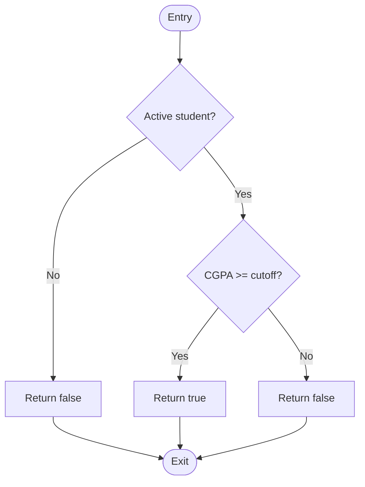

# Experiment 10: Software Metrics and Complexity Analysis

## 1. Aim

To calculate and analyze software metrics, including size-oriented metrics, Halstead metrics, Function Point Analysis, cyclomatic complexity, and control flow graphs using the Student Placement Management System as a case study.

## 2. Objectives

- To understand size-oriented software metrics.
- To calculate Halstead software metrics using operators and operands.
- To estimate software size using Function Point Analysis.
- To calculate cyclomatic complexity using a control flow graph.
- To understand how software metrics support quality measurement and maintenance.

## 3. Tools and Technologies

- Programming Language: Java
- Backend Framework: Spring Boot
- Diagrams: Mermaid
- Documentation: Markdown
- Version Control: Git and GitHub

*Note: The calculations below use illustrative examples for the proposed Student Placement Management System. They are not measurements of a completed application.*

## 4. Introduction

Software metrics are quantitative measures used to evaluate software size, complexity, quality, maintainability, and development effort.

They help software engineers identify complex code, estimate project size, assess testing requirements, and monitor software quality.

The following metrics are analyzed in the context of a student applying for a placement drive.

## 5. Size-Oriented Metrics

### 5.1 Definition

Size-oriented metrics measure software characteristics relative to the size of the source code, commonly measured using Lines of Code (LOC) or thousands of lines of code (KLOC).

### 5.2 Common Metrics

**1. Lines of Code (LOC)**

The number of source-code lines in a program, according to a defined counting convention.

**2. Productivity**

\[
\text{Productivity}=\frac{\text{LOC}}{\text{Person-Months}}
\]

**3. Defect Density**

\[
\text{Defect Density}=\frac{\text{Number of Defects}}{\text{KLOC}}
\]

**4. Cost per LOC**

\[
\text{Cost per LOC}=\frac{\text{Development Cost}}{\text{LOC}}
\]

### 5.3 Illustrative Calculation

Assume a software module has the following measurements:

- Total source LOC = 1,200
- Development effort = 2 person-months
- Defects identified during testing = 6
- Development cost = ₹60,000

**Step 1: Calculate KLOC**

\[
KLOC=\frac{1200}{1000}=1.2
\]

**Step 2: Calculate Productivity**

\[
\text{Productivity}=\frac{1200}{2}=600
\]

Productivity = **600 LOC per person-month**.

**Step 3: Calculate Defect Density**

\[
\text{Defect Density}=\frac{6}{1.2}=5
\]

Defect density = **5 defects per KLOC**.

**Step 4: Calculate Cost per LOC**

\[
\text{Cost per LOC}=\frac{60000}{1200}=₹50
\]

Cost per LOC = **₹50**.

*These figures are hypothetical and are used only to demonstrate the calculations.*

### 5.4 Limitations

- LOC depends on the programming language and coding style.
- More lines of code do not necessarily mean better software.
- Defect density depends on how defects and code size are counted.
- Productivity comparisons are meaningful only when measurement methods and project contexts are comparable.

## 6. Halstead Software Metrics

### 6.1 Definition

Halstead metrics estimate software size and complexity by counting operators and operands in source code.

For calculation, operators and operands must be identified using a consistent counting convention.

The following notation is used:

- \(n_1\): Number of distinct operators.
- \(n_2\): Number of distinct operands.
- \(N_1\): Total occurrences of operators.
- \(N_2\): Total occurrences of operands.

### 6.2 Formulae

**Program vocabulary**

\[
n=n_1+n_2
\]

**Program length**

\[
N=N_1+N_2
\]

**Calculated program length**

\[
\hat N=n_1\log_2 n_1+n_2\log_2 n_2
\]

**Volume**

\[
V=N\log_2(n)
\]

**Difficulty**

\[
D=\frac{n_1}{2}\times\frac{N_2}{n_2}
\]

**Effort**

\[
E=D\times V
\]

**Estimated time**

\[
T=\frac{E}{18}\text{ seconds}
\]

The time formula uses a traditional Halstead convention; it is a theoretical estimate, not a reliable real-world development schedule.

### 6.3 Example Java Code

Consider the following simplified placement eligibility check:

```java
boolean eligible(int cgpa, int cutoff) {
    if (cgpa >= cutoff) {
        return true;
    }
    return false;
}
```

For this example, use the following explicit counting convention:

- Operators: `if`, `>=`, `return`.
- Operands: `eligible`, `cgpa`, `cutoff`, `true`, `false`.
- Each occurrence of an operator or operand is counted separately.
- Braces, parentheses, commas, and type keywords are excluded from this illustrative count.

### 6.4 Operator and Operand Count

| Item | Distinct Count | Total Occurrences |
|---|---:|---:|
| Operators | 3 | 4 |
| Operands | 5 | 6 |

Therefore:

\[
n_1=3,\quad n_2=5
\]

\[
N_1=4,\quad N_2=6
\]

### 6.5 Calculations

**Step 1: Program Vocabulary**

\[
n=n_1+n_2=3+5=8
\]

**Step 2: Program Length**

\[
N=N_1+N_2=4+6=10
\]

**Step 3: Calculated Program Length**

\[
\hat N=3\log_2 3+5\log_2 5
\]

\[
\hat N\approx4.755+11.610=16.365
\]

**Step 4: Volume**

\[
V=N\log_2 n
\]

\[
V=10\log_2 8=10\times3=30
\]

**Step 5: Difficulty**

\[
D=\frac{n_1}{2}\times\frac{N_2}{n_2}
\]

\[
D=\frac{3}{2}\times\frac{6}{5}=1.8
\]

**Step 6: Effort**

\[
E=D\times V
\]

\[
E=1.8\times30=54
\]

**Step 7: Estimated Time**

\[
T=\frac{54}{18}=3\text{ seconds}
\]

### 6.6 Halstead Results

| Metric | Calculated Value |
|---|---:|
| Vocabulary \(n\) | 8 |
| Length \(N\) | 10 |
| Calculated Length \(\hat N\) | 16.365 |
| Volume \(V\) | 30 |
| Difficulty \(D\) | 1.8 |
| Effort \(E\) | 54 |
| Estimated Time \(T\) | 3 seconds |

*The results depend on the chosen token-counting convention. Halstead's estimated time should not be interpreted as the actual time needed to write or understand this method.*

## 7. Function Point Analysis

### 7.1 Definition

Function Point Analysis (FPA) estimates software size by measuring the functionality delivered to users, independently of the programming language.

It evaluates five function types:

- **External Inputs (EI):** Data entering the system, such as a student submitting an application.
- **External Outputs (EO):** Processed outputs, such as a placement report.
- **External Inquiries (EQ):** Requests that retrieve information with limited processing, such as searching placement drives.
- **Internal Logical Files (ILF):** Logical groups of data maintained by the application.
- **External Interface Files (EIF):** Logical groups of data maintained by another application but referenced by the system.

### 7.2 Function Point Formula

Unadjusted Function Points (UFP) are calculated as:

\[
UFP=\sum(\text{Count}\times\text{Weight})
\]

The traditional IFPUG weighting table is:

| Function Type | Low | Average | High |
|---|---:|---:|---:|
| External Inputs (EI) | 3 | 4 | 6 |
| External Outputs (EO) | 4 | 5 | 7 |
| External Inquiries (EQ) | 3 | 4 | 6 |
| Internal Logical Files (ILF) | 7 | 10 | 15 |
| External Interface Files (EIF) | 5 | 7 | 10 |

### 7.3 Illustrative Function Point Calculation

Assume the proposed system has the following estimated counts and complexity classifications:

| Function Type | Count | Complexity | Weight | Total |
|---|---:|---|---:|---:|
| External Inputs (EI) | 4 | Average | 4 | 16 |
| External Outputs (EO) | 3 | Average | 5 | 15 |
| External Inquiries (EQ) | 3 | Average | 4 | 12 |
| Internal Logical Files (ILF) | 4 | Average | 10 | 40 |
| External Interface Files (EIF) | 1 | Average | 7 | 7 |
| **Total UFP** | | | | **90** |

Therefore:

\[
UFP=16+15+12+40+7=90
\]

**Unadjusted Function Points = 90.**

### 7.4 Optional Value Adjustment

In the traditional adjusted Function Point model:

\[
FP=UFP\times VAF
\]

\[
VAF=0.65+0.01\times TDI
\]

Where TDI is the Total Degree of Influence obtained by rating 14 general system characteristics from 0 to 5.

For illustration, assume:

\[
TDI=35
\]

\[
VAF=0.65+(0.01\times35)=1.00
\]

\[
FP=90\times1.00=90
\]

Adjusted Function Points under these illustrative assumptions = **90 FP**.

*The example assumes the traditional value adjustment model. The UFP counts and complexity ratings must be established from actual requirements before using FPA for project estimation.*

### 7.5 Application to the Project

Function Point Analysis can help estimate the functional size of:

- Student registration and profile management.
- Placement drive creation and searching.
- Eligibility checking and application submission.
- Interview scheduling and result management.
- Placement offer tracking.
- Reports and placement statistics.

## 8. Cyclomatic Complexity

### 8.1 Definition

Cyclomatic Complexity measures the number of linearly independent paths through a program's control flow graph.

It helps estimate the minimum number of basis-path tests needed for the modeled control flow.

### 8.2 Formula

For a control flow graph:

\[
M=E-N+2P
\]

Where:

- \(E\) = Number of edges.
- \(N\) = Number of nodes.
- \(P\) = Number of connected components; for one connected program graph, \(P=1\).

For a single connected graph:

\[
M=E-N+2
\]

For structured code with ordinary binary decision points and a single connected graph, complexity can also be calculated as:

\[
M=D+1
\]

Where \(D\) is the number of decision points.

### 8.3 Example: Placement Eligibility Check

```java
boolean eligible(int cgpa, int cutoff, boolean active) {
    if (!active) {
        return false;
    }

    if (cgpa >= cutoff) {
        return true;
    }

    return false;
}
```

The method contains two decision points:

1. `if (!active)`
2. `if (cgpa >= cutoff)`

Therefore:

\[
M=D+1
\]

\[
M=2+1=3
\]

**Cyclomatic Complexity = 3.**

This means three independent basis paths are sufficient to represent the method's control flow.

### 8.4 Interpretation

- Complexity 1: No decision points.
- Complexity 2: One binary decision point.
- Complexity 3: Two binary decision points in a simple structured method.
- Higher complexity: More independent paths and potentially greater testing effort.

These are general interpretations, not universal pass/fail thresholds. Actual maintainability also depends on code structure, nesting, naming, and business logic.

## 9. Control Flow Graph (CFG)

### 9.1 Definition

A Control Flow Graph represents the possible execution paths of a program.

- **Nodes:** Statements or groups of statements.
- **Edges:** Possible transfers of control.
- **Decision nodes:** Points where execution can branch.
- **Entry node:** The beginning of the method.
- **Exit node:** The end of the method.

### 9.2 Control Flow Graph for the Eligibility Method



### 9.3 Node and Edge Count

Using the graph above:

Nodes:

1. Entry
2. Active student decision
3. Return false for inactive student
4. CGPA decision
5. Return true
6. Return false for insufficient CGPA
7. Exit

Therefore:

\[
N=7
\]

Edges:

1. Entry → Active decision
2. Active decision → First return false
3. Active decision → CGPA decision
4. First return false → Exit
5. CGPA decision → Return true
6. CGPA decision → Second return false
7. Return true → Exit
8. Second return false → Exit

Therefore:

\[
E=8
\]

Since the graph is connected:

\[
P=1
\]

Now calculate:

\[
M=E-N+2P
\]

\[
M=8-7+2(1)=3
\]

**Cyclomatic Complexity from CFG = 3.**

This matches the result obtained from the two decision points.

### 9.4 Basis Paths

Three independent paths through the method are:

1. Entry → Active decision (No) → Return false → Exit.
2. Entry → Active decision (Yes) → CGPA decision (Yes) → Return true → Exit.
3. Entry → Active decision (Yes) → CGPA decision (No) → Return false → Exit.

These paths provide a basis for designing tests, although complete testing may require additional cases for boundaries, invalid input, and integration behavior.

## 10. Comparison of Software Metrics

| Metric | Measures | Primary Use |
|---|---|---|
| LOC / KLOC | Source-code size | Size tracking and normalized metrics |
| Productivity | Code size per unit effort | Development measurement, with context |
| Defect Density | Defects per KLOC | Quality trend analysis |
| Halstead Metrics | Operators, operands, volume, and effort | Approximate code complexity analysis |
| Function Points | User-visible functional size | Effort and project-size estimation |
| Cyclomatic Complexity | Independent control-flow paths | Testing and complexity assessment |
| Control Flow Graph | Program execution structure | Path analysis and test design |

## 11. Industry Mapping: Software Quality Measurement

Software Quality Measurement uses defined metrics to assess software characteristics and guide engineering decisions.

The metrics in this experiment support industry practices in the following ways:

1. **Size Estimation:** LOC and Function Points help describe software size using different approaches.
2. **Effort Estimation:** Function Points can support effort estimates when calibrated with historical project data.
3. **Code Review:** Halstead metrics and cyclomatic complexity can help identify code requiring additional review.
4. **Test Planning:** Control flow graphs and cyclomatic complexity support basis-path test design.
5. **Quality Monitoring:** Defect density helps teams monitor defect trends when measurement methods remain consistent.
6. **Maintainability:** Metrics can highlight potentially complex modules that may benefit from refactoring.
7. **Continuous Improvement:** Teams can compare metrics across releases and use the results to prioritize improvements.

### Important Industry Considerations

- Metrics should support engineering judgment rather than replace it.
- A single metric cannot fully represent software quality.
- Measurements require consistent definitions and counting rules.
- Targets should be based on the project's context and historical data.
- Metrics should not be used alone to compare developers or measure individual productivity.

## 12. Expected Outcomes

After completing this experiment, the following outcomes are expected:

- Understanding of size-oriented metrics and their limitations.
- Calculation of Halstead metrics from a defined token-counting convention.
- Estimation of functional size using Function Point Analysis.
- Calculation of cyclomatic complexity from decision points and CFG structure.
- Ability to identify independent control-flow paths.
- Understanding of how software metrics contribute to quality measurement.

## 13. Conclusion

This experiment analyzed software metrics using the Student Placement Management System as a case study. Size-oriented metrics were calculated using LOC, effort, cost, and defect data. Halstead metrics were derived from operators and operands. Function Point Analysis was demonstrated using estimated functional counts, while cyclomatic complexity was calculated from both decision points and a control flow graph.

These techniques provide complementary information about software size, functionality, and control-flow complexity. Their appropriate use can improve estimation, testing, code review, and software quality management.

## 14. Result

The Metrics Calculation Report was prepared with illustrative calculations for size-oriented metrics, Halstead metrics, Function Point Analysis, and cyclomatic complexity. A control flow graph was also developed and verified using the cyclomatic complexity formula. The report demonstrates the application of software metrics to Software Quality Measurement.
