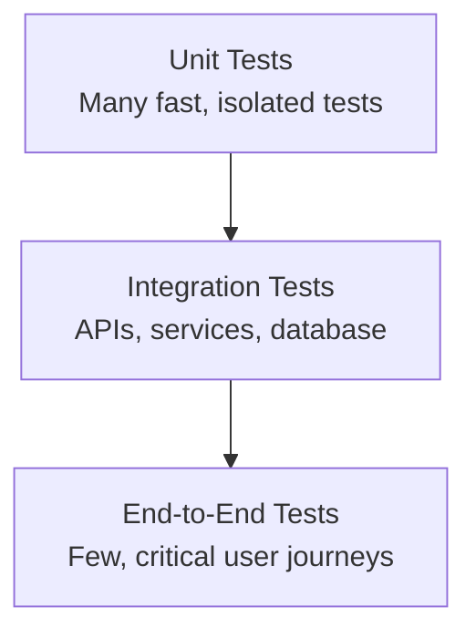

# Experiment 11: Unit and Integration Testing

## 1. Aim

To prepare a test case document for the Student Placement Management System and understand unit testing, integration testing, test case design, and basic white-box testing techniques.

## 2. Objectives

- To understand software testing and its importance.
- To design test cases with expected results and execution status.
- To understand unit testing using JUnit.
- To study integration testing strategies.
- To understand white-box testing techniques, including statement and branch coverage.
- To document testing activities using industry-standard practices.

## 3. Tools and Technologies

- Programming Language: Java
- Testing Framework: JUnit 5
- Backend Framework: Spring Boot
- Database: PostgreSQL
- Testing Approach: Manual and automated testing
- Documentation: Markdown and GitHub

*Note: The examples demonstrate a proposed testing approach. Test execution results must be recorded after the application and tests have actually been run.*

## 4. Introduction

Software testing is the process of evaluating a software system to identify defects and verify that it satisfies specified requirements.

The Student Placement Management System manages student profiles, placement drives, eligibility verification, applications, interviews, and placement offers. Testing helps ensure that these features behave correctly, handle invalid inputs, and interact properly with the database and other components.

Two important testing levels are:

- **Unit Testing:** Tests individual methods or components independently.
- **Integration Testing:** Tests interactions between multiple components, such as services, repositories, controllers, and databases.

White-box testing complements these approaches by designing tests based on the internal structure and control flow of the code.

## 5. Test Case Design

### 5.1 Definition

A test case is a documented set of inputs, preconditions, execution steps, and expected results used to verify a particular software behavior.

### 5.2 Components of a Test Case

- **Test Case ID:** Unique identifier.
- **Test Scenario:** Functionality being tested.
- **Preconditions:** Conditions required before execution.
- **Test Steps:** Actions performed by the tester.
- **Test Data:** Inputs supplied to the system.
- **Expected Result:** Correct behavior according to requirements.
- **Actual Result:** Behavior observed during execution.
- **Status:** Pass, Fail, Blocked, or Not Executed.

### 5.3 Test Case Document

The following test cases cover the main workflows of the proposed Student Placement Management System.

| Test Case ID | Test Scenario | Test Data / Preconditions | Expected Result | Status |
|---|---|---|---|---|
| TC-01 | Student login with valid credentials | Registered student and correct password | Student is authenticated and redirected appropriately | Not Executed |
| TC-02 | Student login with invalid credentials | Incorrect password | Login is rejected with a suitable error message | Not Executed |
| TC-03 | Register a student with valid details | Unique email and valid profile details | Student account is created successfully | Not Executed |
| TC-04 | Register with an already registered email | Existing email address | Duplicate registration is rejected | Not Executed |
| TC-05 | View available placement drives | At least one published drive exists | Published drives are displayed | Not Executed |
| TC-06 | Apply when eligible | Student satisfies the drive criteria and has not applied | Application is saved successfully | Not Executed |
| TC-07 | Apply when ineligible | Student does not satisfy a required criterion | Application is rejected with a suitable explanation | Not Executed |
| TC-08 | Apply twice to the same drive | An application already exists | Duplicate application is prevented | Not Executed |
| TC-09 | Create a placement drive | Authorized placement officer and valid drive details | Placement drive is created | Not Executed |
| TC-10 | Unauthorized user creates a drive | Student attempts a restricted operation | Access is denied | Not Executed |
| TC-11 | Update application status | Authorized recruiter and valid application | Status is updated successfully | Not Executed |
| TC-12 | View placement report | Authorized placement officer | Report displays relevant placement statistics | Not Executed |

*All statuses remain Not Executed until the corresponding tests are actually performed.*

### 5.4 Detailed Test Case Example

**Test Case ID:** TC-06

**Test Scenario:** Eligible student applies for a placement drive.

**Preconditions:**

- Student is logged in.
- Student profile contains the required academic details.
- Placement drive is published and open for applications.
- Student meets all eligibility criteria.
- No existing application exists for the same student and drive.

**Test Data:**

- Student CGPA: 8.2
- Required minimum CGPA: 7.0
- Application status: Applied

**Test Steps:**

1. Log in as a student.
2. Open the available placement drives page.
3. Select a placement drive.
4. Click the Apply button.
5. Confirm the application submission.

**Expected Result:**

The system verifies eligibility, saves the application, and displays a success message. A duplicate application must not be created.

**Actual Result:** To be recorded after execution.

**Status:** Not Executed.

## 6. Unit Testing

### 6.1 Definition

Unit testing verifies the behavior of an individual method, class, or small component independently of the rest of the application.

For example, the eligibility-checking method can be tested without starting the complete web application.

### 6.2 Objectives of Unit Testing

- Verify individual business rules.
- Detect defects early.
- Test valid and invalid inputs.
- Check boundary conditions.
- Make refactoring safer.
- Reduce dependence on external systems during testing.

### 6.3 Example Java Method

The following method represents a simplified eligibility rule:

```java
public class EligibilityService {

    public boolean isEligible(double cgpa, double cutoff) {
        return cgpa >= cutoff;
    }
}
```

This is an illustrative method. A real application may also need to check active student status, backlogs, degree requirements, and drive-specific conditions.

### 6.4 JUnit 5 Test Cases

```java
import org.junit.jupiter.api.Test;

import static org.junit.jupiter.api.Assertions.*;

class EligibilityServiceTest {

    private final EligibilityService service =
            new EligibilityService();

    @Test
    void shouldReturnTrueWhenCgpaExceedsCutoff() {
        assertTrue(service.isEligible(8.2, 7.0));
    }

    @Test
    void shouldReturnTrueWhenCgpaEqualsCutoff() {
        assertTrue(service.isEligible(7.0, 7.0));
    }

    @Test
    void shouldReturnFalseWhenCgpaIsBelowCutoff() {
        assertFalse(service.isEligible(6.5, 7.0));
    }
}
```

### 6.5 Explanation

- `@Test` identifies a test method.
- `assertTrue()` verifies that the result is `true`.
- `assertFalse()` verifies that the result is `false`.
- Each test checks a separate input condition.
- The equality test verifies the boundary condition where CGPA equals the cutoff.

### 6.6 Expected Unit Test Results

| Test Method | Input | Expected Output |
|---|---|---|
| `shouldReturnTrueWhenCgpaExceedsCutoff` | 8.2, 7.0 | `true` |
| `shouldReturnTrueWhenCgpaEqualsCutoff` | 7.0, 7.0 | `true` |
| `shouldReturnFalseWhenCgpaIsBelowCutoff` | 6.5, 7.0 | `false` |

These are expected results based on the method's logic; they are not claims that the tests have already been executed.

## 7. Integration Testing

### 7.1 Definition

Integration testing verifies that two or more software components work correctly together.

In the Student Placement Management System, integration testing can verify interactions among the controller, service, repository, and PostgreSQL database.

### 7.2 Example Integration Workflow

When a student applies for a placement drive:

1. The frontend sends an HTTP request to the application controller.
2. The controller validates the request and invokes the service.
3. The service checks eligibility and existing applications.
4. The repository interacts with the database.
5. The service returns the outcome to the controller.
6. The controller sends the HTTP response to the client.

Integration testing verifies that these interactions produce the expected result.

### 7.3 Integration Testing Strategies

**1. Big Bang Integration Testing**

All or most modules are integrated at once and then tested together.

- Advantage: Simple to begin when all modules are available.
- Limitation: Defects can be difficult to isolate.

**2. Top-Down Integration Testing**

Testing begins with higher-level modules and progressively integrates lower-level components. Stubs can simulate components that are not yet available.

- Advantage: High-level workflows can be tested early.
- Limitation: Lower-level components may be tested later.

**3. Bottom-Up Integration Testing**

Testing begins with lower-level components and progressively integrates higher-level components. Drivers can simulate higher-level modules that are not yet available.

- Advantage: Lower-level services and data-access components can be verified early.
- Limitation: Complete user workflows may be available only later.

**4. Incremental Integration Testing**

Components are integrated and tested in small groups rather than all at once. Top-down and bottom-up are common incremental approaches.

- Advantage: Defects are easier to isolate.
- Limitation: Requires planning of interfaces and integration order.

### 7.4 Proposed Integration Test Cases

| Test Case ID | Components Integrated | Test Scenario | Expected Result |
|---|---|---|---|
| IT-01 | Controller + Service | Submit a valid application request | Appropriate service operation is invoked and a correct response is returned |
| IT-02 | Service + Repository + Database | Save a valid application | Application is persisted correctly |
| IT-03 | Application Service + Eligibility Service | Submit an ineligible application | Application is rejected and not saved |
| IT-04 | Application Service + Database | Submit the same application twice | Duplicate application is prevented |
| IT-05 | Authentication + Authorization + Controller | Student attempts an administrator-only operation | Access is denied |
| IT-06 | Reporting Service + Repository + Database | Generate placement statistics | Report reflects the stored data accurately |

### 7.5 Integration Testing Recommendation

For a Spring Boot application, use automated integration tests to verify API behavior and database interactions. A test database or isolated test environment should be used to avoid unintentionally modifying production data.

Spring Boot's testing support and JUnit can help test controllers, services, repositories, and application context configuration.

## 8. White-Box Testing Basics

### 8.1 Definition

White-box testing is a testing technique in which test cases are designed using knowledge of the internal code structure, conditions, branches, and execution paths.

### 8.2 Common Techniques

**1. Statement Coverage**

Measures whether executable statements have been executed.

\[
\text{Statement Coverage}=
\frac{\text{Executed Statements}}{\text{Total Statements}}
\times100
\]

**2. Branch Coverage**

Measures whether each decision outcome, such as True and False, has been executed.

\[
\text{Branch Coverage}=
\frac{\text{Executed Branches}}{\text{Total Branches}}
\times100
\]

**3. Condition Testing**

Checks individual Boolean conditions with appropriate True and False values.

**4. Basis-Path Testing**

Uses cyclomatic complexity to identify a set of linearly independent execution paths for testing.

### 8.3 Example

Consider the eligibility condition:

```java
if (cgpa >= cutoff) {
    return true;
}
return false;
```

Two useful tests are:

- `cgpa = 8.0`, `cutoff = 7.0`: condition is True.
- `cgpa = 6.0`, `cutoff = 7.0`: condition is False.

These tests exercise both outcomes of the decision.

### 8.4 Coverage Calculation

Assume a small method contains four executable statements and all four are executed by the test suite.

\[
\text{Statement Coverage}=\frac{4}{4}\times100=100\%
\]

If a decision has two branches and both branches are executed:

\[
\text{Branch Coverage}=\frac{2}{2}\times100=100\%
\]

Full statement coverage does not automatically guarantee full branch coverage or prove that the software is defect-free.

## 9. Manual Testing Template

The following template can be used to record actual test execution.

| Field | Details |
|---|---|
| Test Case ID | Unique identifier |
| Test Scenario | Feature or behavior under test |
| Preconditions | Required setup |
| Test Steps | Ordered execution steps |
| Test Data | Inputs used |
| Expected Result | Requirement-based expected behavior |
| Actual Result | Observed behavior |
| Status | Pass / Fail / Blocked / Not Executed |
| Defect ID | Identifier of a logged defect, if any |
| Remarks | Additional observations |

### Execution Guidelines

1. Prepare the test environment.
2. Execute each test case using the documented steps.
3. Record the actual result.
4. Compare the actual result with the expected result.
5. Mark the test as Pass or Fail.
6. Record and track any defects.
7. Re-run affected tests after fixes.

## 10. Industry Mapping: Software Testing Practices

Software Testing Practices establish repeatable methods for verifying functionality, identifying defects, and maintaining confidence in software changes.

| Industry Practice | Application in the Project |
|---|---|
| Test Case Design | Documenting scenarios, preconditions, inputs, and expected results |
| Unit Testing | Testing individual business methods using JUnit |
| Integration Testing | Verifying interactions between controllers, services, repositories, and databases |
| White-Box Testing | Measuring statement and branch coverage |
| Regression Testing | Re-running existing tests after code changes |
| Defect Tracking | Recording failures and following them through resolution |
| Test Automation | Executing automated tests during development and CI pipelines |
| Test Data Management | Using controlled test data and isolated environments |
| Requirement Traceability | Mapping test cases to functional requirements |

### Recommended Testing Pyramid



The testing pyramid recommends maintaining a broad base of fast unit tests, supported by integration tests and a smaller number of end-to-end tests for critical workflows.

## 11. Expected Outcomes

After completing this experiment, the following outcomes are expected:

- A documented set of test cases for key application features.
- Understanding of unit testing using JUnit.
- Understanding of integration testing strategies.
- Ability to design basic white-box tests.
- Familiarity with statement and branch coverage.
- Understanding of test execution records and defect tracking.

## 12. Conclusion

This experiment prepared a test case document for the proposed Student Placement Management System. It covered manual test case design, unit testing using JUnit 5, integration testing strategies, and basic white-box testing techniques.

These practices help verify individual components, ensure correct interactions between components, identify defects early, and improve software quality.

## 13. Result

The Test Case Document was prepared with illustrative manual test cases, sample JUnit tests, integration test scenarios, and white-box testing coverage calculations. Actual execution results are to be recorded after running the tests in the application environment.
