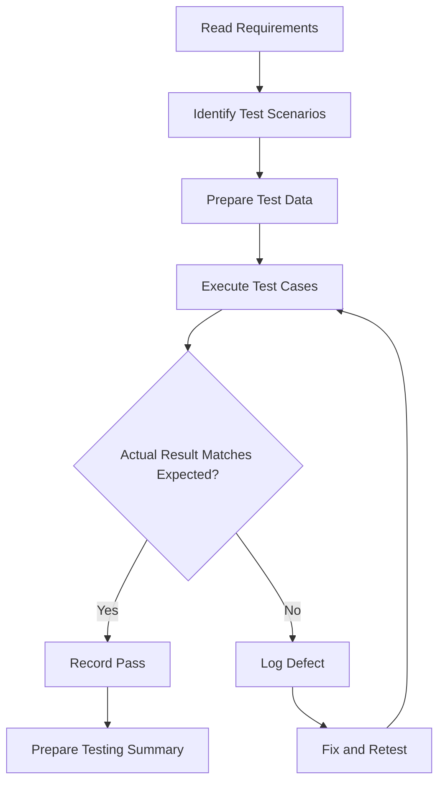

# Experiment 12: Functional and Performance Testing

## 1. Aim

To prepare a Testing Report for the Student Placement Management System by studying black-box testing, functional testing, load testing, stress testing, and regression testing.

## 2. Objectives

- To understand black-box testing techniques.
- To design functional test cases based on system requirements.
- To understand load and stress testing.
- To study regression testing and its importance.
- To identify performance metrics used to evaluate software quality.
- To understand the role of Quality Assurance Engineering in software development.

## 3. Tools and Technologies

- Application Backend: Java and Spring Boot
- Frontend: Next.js / React
- Database: PostgreSQL
- Functional Testing: Manual testing and JUnit
- API Testing: Postman
- Performance Testing: Apache JMeter
- Documentation: Markdown and GitHub

*Note: These tools are proposed for the testing workflow. The report contains illustrative test scenarios and hypothetical performance targets; actual results must be recorded after execution.*

## 4. Introduction

Software testing verifies whether an application satisfies its functional requirements and performs reliably under expected operating conditions.

The Student Placement Management System manages student registration, placement drives, eligibility verification, applications, interview scheduling, and placement reports.

Testing this system helps identify functional defects, incorrect responses, performance bottlenecks, and regressions introduced by code changes.

This report covers five important testing areas: black-box testing, functional testing, load testing, stress testing, and regression testing.

## 5. Black-Box Testing

### 5.1 Definition

Black-box testing verifies software behavior by providing inputs and checking outputs without requiring knowledge of the internal implementation.

The tester focuses on requirements, user interactions, input validation, and observable system behavior.

### 5.2 Black-Box Testing Techniques

**1. Equivalence Partitioning**

Inputs are divided into groups expected to behave similarly.

Example: If a placement drive requires a minimum CGPA of 7.0, inputs below 7.0 and inputs at or above 7.0 can be treated as different equivalence partitions.

**2. Boundary Value Analysis**

Tests values at and around important boundaries.

For a minimum CGPA of 7.0, useful test values are:

- 6.9 — below the cutoff.
- 7.0 — exactly at the cutoff.
- 7.1 — above the cutoff.

**3. Decision Table Testing**

Tests combinations of conditions and their corresponding outcomes.

For example, application eligibility may depend on CGPA, active student status, and whether the application deadline has passed.

**4. State Transition Testing**

Checks whether the application correctly moves between states.

Example:

`Applied → Shortlisted → Interview Scheduled → Selected`

The system should reject invalid transitions according to the defined business rules.

### 5.3 Black-Box Testing Example

| Test Case ID | Input / Condition | Expected Result |
|---|---|---|
| BB-01 | CGPA is below 7.0 | Student is marked ineligible |
| BB-02 | CGPA equals 7.0 and all other criteria pass | Student passes the CGPA criterion |
| BB-03 | CGPA is above 7.0 and all other criteria pass | Student passes the CGPA criterion |
| BB-04 | Application submitted after the deadline | Submission is rejected |
| BB-05 | Student submits the same application twice | Duplicate application is prevented |
| BB-06 | Student accesses an administrator-only endpoint | Access is denied |

*Passing the CGPA criterion alone does not guarantee overall eligibility; all applicable requirements must be satisfied.*

## 6. Functional Testing

### 6.1 Definition

Functional testing verifies whether software features behave according to specified functional requirements.

It checks what the system does rather than measuring how fast it performs.

### 6.2 Functional Testing Scenarios

The following scenarios cover the main workflows of the Student Placement Management System.

| Test Case ID | Functionality | Test Steps | Expected Result | Status |
|---|---|---|---|---|
| FT-01 | Student Login | Enter valid registered credentials | User is authenticated successfully | Not Executed |
| FT-02 | Invalid Login | Enter an incorrect password | Login is rejected with an appropriate error | Not Executed |
| FT-03 | Student Registration | Submit valid unique registration details | Student account is created | Not Executed |
| FT-04 | View Placement Drives | Open the published drives page | Available published drives are displayed | Not Executed |
| FT-05 | Eligible Application | Apply to a drive while satisfying its criteria | Application is saved successfully | Not Executed |
| FT-06 | Ineligible Application | Apply without meeting a required criterion | Application is rejected | Not Executed |
| FT-07 | Duplicate Application | Apply twice to the same drive | Duplicate application is prevented | Not Executed |
| FT-08 | Create Placement Drive | Placement officer submits valid drive details | Drive is created successfully | Not Executed |
| FT-09 | Role-Based Authorization | Student attempts a restricted administrative operation | Access is denied | Not Executed |
| FT-10 | Placement Report | Authorized officer requests placement statistics | Correct report is returned | Not Executed |

### 6.3 Functional Testing Workflow

### 6.4 Acceptance Criteria

The system should satisfy the following criteria before the corresponding functionality is accepted:

- Valid users can log in, subject to authentication rules.
- Invalid credentials are rejected.
- Only authorized users can perform restricted operations.
- Eligibility rules are applied correctly.
- Duplicate applications are prevented.
- Placement drive and application data are persisted correctly.
- Reports return data consistent with the underlying records.

## 7. Performance Testing

### 7.1 Definition

Performance testing evaluates the responsiveness, stability, resource usage, and scalability of a system under specified workloads.

It helps determine whether the application can meet performance expectations during normal and high-demand periods.

### 7.2 Important Performance Metrics

**1. Response Time:** Time taken to return a response to a request.

**2. Throughput:** Number of requests processed per unit of time.

**3. Error Rate:** Percentage of requests that fail.

\[
\text{Error Rate}=\frac{\text{Failed Requests}}{\text{Total Requests}}\times100
\]

**4. Resource Utilization:** CPU, memory, database connections, and other resources consumed under load.

**5. Percentile Latency:** Measures such as p95 and p99 indicate the response time below which 95% or 99% of observed requests complete.

### 7.3 Load Testing

Load testing measures application behavior under an expected or specified workload.

Example scenario:

- Simulate 100 concurrent virtual users.
- Users browse placement drives and view application status.
- Run the test for 10 minutes after a suitable ramp-up.
- Record response times, throughput, errors, CPU usage, and database behavior.

The goal is to determine whether the system meets its defined performance targets under expected demand.

### 7.4 Stress Testing

Stress testing evaluates the application beyond its expected operating load to identify its limits and failure behavior.

Example scenario:

- Start with 100 virtual users.
- Increase the load gradually to 200, 300, and 400 users.
- Observe response times, errors, resource usage, and database connections.
- Stop or reduce the workload if the test environment becomes unstable.

The objective is to identify bottlenecks, determine the point at which service degrades, and assess recovery after the load decreases.

*Stress testing must be conducted in an authorized, isolated test environment—not against production systems without approval.*

## 8. Load Testing vs Stress Testing

| Basis | Load Testing | Stress Testing |
|---|---|---|
| Purpose | Verify performance under expected demand | Discover limits and failure behavior |
| Workload | Expected or specified workload | Beyond expected operating workload |
| Main focus | Response time, throughput, error rate | Bottlenecks, degradation, recovery |
| Result | Whether performance targets are met | Capacity limits and failure characteristics |
| Example | 100 concurrent users | Increasing workload from 100 to 400 users |

## 9. Proposed Performance Test Plan

The following targets are illustrative starting points and should be finalized based on actual requirements and the test environment.

| Test ID | Scenario | Proposed Workload | Illustrative Acceptance Target |
|---|---|---|---|
| PT-01 | Browse placement drives | 100 concurrent users for 10 minutes | p95 response time ≤ 2 seconds |
| PT-02 | View application status | 100 concurrent users | Error rate below 1% |
| PT-03 | Submit placement applications | 50 concurrent users | No duplicate applications; correct results |
| PT-04 | Increase system workload | Gradually increase users from 100 to 400 | Identify the load level at which targets are no longer met |
| PT-05 | Recovery after stress | Reduce workload after overload | Service returns to acceptable behavior without data corruption |

Performance targets must be assessed alongside hardware, network conditions, test data, and workload design. They are not universal industry thresholds.

## 10. Regression Testing

### 10.1 Definition

Regression testing verifies that previously working functionality continues to work after code changes, bug fixes, configuration updates, or new feature additions.

### 10.2 Importance

Changes to one module can unintentionally affect other modules.

For example, changing placement eligibility logic may affect application submission, application status, and placement reports.

Regression testing helps detect such unintended side effects.

### 10.3 Regression Test Cases

| Test Case ID | Recent Change | Regression Scenario | Expected Result |
|---|---|---|---|
| RT-01 | Login logic updated | Test valid and invalid login | Authentication still works correctly |
| RT-02 | Eligibility rules changed | Test students above, below, and at the cutoff | Eligibility outcomes remain correct |
| RT-03 | Application service updated | Submit a new application | Valid application is persisted |
| RT-04 | Duplicate prevention updated | Submit the same application twice | Duplicate remains prevented |
| RT-05 | Database schema modified | Retrieve student profile | Profile data is stored and retrieved correctly |
| RT-06 | Reporting logic updated | Generate placement statistics | Counts and totals remain accurate |
| RT-07 | Authorization rules changed | Student accesses an administrative endpoint | Unauthorized access remains blocked |

### 10.4 Regression Testing Process

1. Identify the code changes and affected modules.
2. Select relevant existing test cases.
3. Run automated unit and integration tests.
4. Execute critical manual test cases where needed.
5. Compare actual results with expected results.
6. Record and investigate failures.
7. Re-run affected tests after fixes.

Automating repeatable regression tests
