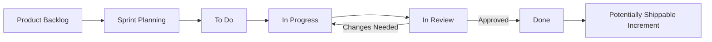

# Experiment 13: Agile Workflow and Project Management

## 1. Aim

To understand Agile methodology, Scrum practices, sprint planning, backlog creation, and Scrum board management using the Student Placement Management System as a case study.

## 2. Objectives

- To understand the Agile software development methodology.
- To identify Scrum roles, events, and artifacts.
- To create a product backlog based on project requirements.
- To prepare a sprint plan with tasks, priorities, and acceptance criteria.
- To demonstrate a Scrum board using GitHub Projects or Trello.
- To understand how Agile practices are applied in industry workflows.

## 3. Tools and Technologies

- Project Management: GitHub Projects or Trello
- Version Control: Git and GitHub
- Backend: Java and Spring Boot
- Frontend: Next.js / React
- Database: PostgreSQL
- Documentation: Markdown

*Note: GitHub Projects or Trello can be used to implement the proposed Agile board. The board below is a design example; it does not claim that an external board has already been created.*

## 4. Introduction to Agile Methodology

Agile is an iterative and incremental approach to software development in which teams deliver software in small increments, incorporate feedback, and adapt to changing requirements.

Instead of completing the entire application before delivering anything, Agile teams divide work into manageable tasks and deliver useful functionality in repeated cycles.

### 4.1 Agile Principles

- Deliver working software frequently.
- Welcome changing requirements when they provide value.
- Encourage collaboration between stakeholders and developers.
- Maintain continuous communication within the team.
- Focus on working software as a measure of progress.
- Improve the development process through regular feedback.

### 4.2 Agile in the Student Placement Management System

The project can be developed incrementally:

- **Sprint 1:** Project setup, authentication, and user roles.
- **Sprint 2:** Student profiles and resume management.
- **Sprint 3:** Placement drive management and eligibility checking.
- **Sprint 4:** Application submission and status tracking.
- **Sprint 5:** Interview management, offers, and reporting.
- **Sprint 6:** Testing, bug fixing, and release preparation.

These are proposed sprint boundaries and can be adjusted according to team size, sprint duration, dependencies, and priorities.

## 5. Scrum Framework

Scrum is an Agile framework that helps teams organize complex work into short, time-boxed iterations called Sprints.

### 5.1 Scrum Roles

**1. Product Owner**

- Defines and communicates the product goal.
- Orders the product backlog according to value and priorities.
- Clarifies requirements and acceptance criteria.

**2. Scrum Master**

- Helps the team understand and apply Scrum.
- Facilitates Scrum events when needed.
- Helps address impediments and improve team effectiveness.

**3. Developers**

- Build, test, and integrate the product increment.
- Estimate and organize work during sprint planning.
- Collaborate to achieve the Sprint Goal.

*For a student project, one person may perform multiple responsibilities, but the responsibilities should remain clear.*

### 5.2 Scrum Events

| Event | Purpose | Typical Timing |
|---|---|---|
| Sprint | Time-boxed period for creating an increment | One to four weeks |
| Sprint Planning | Establishes the Sprint Goal and plans the work | At the start of the Sprint |
| Daily Scrum | Inspects progress toward the Sprint Goal and adapts the plan | 15 minutes for Developers |
| Sprint Review | Inspects the increment and discusses future adaptations | Near the end of the Sprint |
| Sprint Retrospective | Identifies improvements to the team's process | After the Sprint Review and before the next Sprint |

### 5.3 Scrum Artifacts

- **Product Backlog:** Ordered list of work needed to improve the product.
- **Sprint Backlog:** Sprint Goal, selected Product Backlog items, and the plan for delivering them.
- **Increment:** Usable product functionality that meets the Definition of Done.

## 6. Product Backlog Creation

### 6.1 Definition

A product backlog is an ordered and evolving list of product work. Items can represent features, enhancements, defects, or technical improvements.

### 6.2 Product Backlog for the Project

| ID | User Story | Priority | Acceptance Criteria |
|---|---|---|---|
| PB-01 | As a student, I want to register an account so that I can use the placement portal. | High | Valid unique details create an account; duplicate email is rejected. |
| PB-02 | As a user, I want to log in securely so that I can access authorized features. | High | Valid credentials authenticate; invalid credentials are rejected. |
| PB-03 | As a student, I want to manage my profile so that recruiters can review my details. | High | Authorized students can view and update their permitted profile fields. |
| PB-04 | As a student, I want to upload a resume so that recruiters can review it. | Medium | Accepted files can be uploaded and associated with the student's profile. |
| PB-05 | As a placement officer, I want to create placement drives so that students can view opportunities. | High | Authorized officers can create drives with required details. |
| PB-06 | As a student, I want to view placement drives so that I can find relevant opportunities. | High | Published drives are displayed with key details. |
| PB-07 | As a student, I want to check my eligibility so that I know whether I can apply. | High | Eligibility is evaluated using the drive's configured criteria. |
| PB-08 | As a student, I want to apply for a drive so that recruiters can consider my application. | High | Eligible students can apply; duplicate applications are prevented. |
| PB-09 | As a recruiter, I want to review applications so that I can shortlist candidates. | Medium | Authorized recruiters can access relevant applications and update allowed statuses. |
| PB-10 | As a placement officer, I want to manage interviews so that candidates can be scheduled. | Medium | Interview details and results are recorded for relevant candidates. |
| PB-11 | As a student, I want to track my application status so that I know my progress. | Medium | The student can view the status of their own applications. |
| PB-12 | As a placement officer, I want to generate reports so that I can analyze placement outcomes. | Low | Authorized officers can view accurate placement statistics. |

### 6.3 Prioritization

The backlog can be ordered using factors such as:

- Business value.
- User impact.
- Dependencies.
- Technical risk.
- Effort required.

High-priority authentication and core placement workflows should generally be addressed before non-essential reporting enhancements.

## 7. Sprint Planning

### 7.1 Definition

Sprint Planning is the Scrum event in which the team establishes why the Sprint is valuable, what can be completed, and how the selected work will be delivered.

### 7.2 Proposed Sprint 1

**Sprint Duration:** 2 weeks

**Sprint Goal:** Establish the initial application foundation and enable secure student registration and login.

**Selected Backlog Items:**

- PB-01: Student registration.
- PB-02: User login.
- Basic project setup and database configuration.

### 7.3 Sprint Task Breakdown

| Task ID | Task | Owner | Estimate |
|---|---|---|---:|
| ST-01 | Initialize GitHub repository and project structure | Developer A | 2 hours |
| ST-02 | Set up the Spring Boot backend | Developer A | 4 hours |
| ST-03 | Configure PostgreSQL and initial schema | Developer A | 4 hours |
| ST-04 | Design registration and login pages | Developer B | 5 hours |
| ST-05 | Implement registration API | Developer A | 5 hours |
| ST-06 | Implement authentication and authorization basics | Developer A | 6 hours |
| ST-07 | Integrate frontend with backend APIs | Developer B | 5 hours |
| ST-08 | Write and execute relevant tests | Developers A and B | 4 hours |
| ST-09 | Review changes and update documentation | Entire team | 2 hours |

*Estimates are illustrative and should be revised based on the team's capacity and technical experience.*

### 7.4 Sprint Goal and Completion Criteria

The Sprint is considered successful when:

- Registration and login workflows satisfy their acceptance criteria.
- Invalid input and duplicate registration are handled appropriately.
- Sensitive credentials are not exposed in frontend code or logs.
- Relevant automated tests pass.
- Code changes are reviewed and integrated.
- The completed functionality satisfies the team's Definition of Done.

## 8. Scrum Board Demonstration

### 8.1 Definition

A Scrum board is a visual representation of Sprint Backlog work. It helps the team track task status and identify work that is blocked or taking longer than expected.

### 8.2 Sample Scrum Board

The following board demonstrates how Sprint 1 tasks may be organized.

| To Do | In Progress | In Review | Done |
|---|---|---|---|
| ST-01: Initialize repository | ST-05: Registration API | ST-04: Login page review | — |
| ST-02: Set up backend | ST-06: Authentication | — | — |
| ST-03: Configure database | — | — | — |
| ST-07: API integration | — | — | — |
| ST-08: Write tests | — | — | — |
| ST-09: Update documentation | — | — | — |

*This is an illustrative board layout. Move tasks to Done only after the work satisfies the team's Definition of Done.*

### 8.3 Board Workflow

### 8.4 Recommended Board Fields

Each card in GitHub Projects or Trello should include:

- Task ID and title.
- User story or requirement reference.
- Assignee.
- Priority.
- Status.
- Estimate.
- Acceptance criteria.
- Due date, if required.
- Related issue or pull request.

## 9. Setting Up the Agile Board in GitHub Projects

1. Open the GitHub repository for the Student Placement Management System.
2. Create a GitHub Project using the Projects section.
3. Choose a board layout.
4. Create columns or a status field for **Todo**, **In Progress**, **In Review**, and **Done**.
5. Add the Sprint 1 tasks as issues or project items.
6. Assign task owners and add priorities and estimates.
7. Link relevant issues to pull requests.
8. Update task status as work progresses.
9. Review unfinished work and completed outcomes during the Sprint Review.

Trello can also be used by creating a board with equivalent lists and cards.

## 10. Agile Workflow in Industry

A typical Agile workflow follows this cycle:

1. **Requirement Gathering:** Identify user needs and business goals.
2. **Backlog Creation:** Convert requirements into ordered product backlog items.
3. **Sprint Planning:** Define the Sprint Goal and select achievable work.
4. **Development:** Implement features in small increments.
5. **Continuous Testing:** Validate code changes through automated and manual tests.
6. **Code Review:** Review changes before integration.
7. **Sprint Review:** Demonstrate the increment and collect feedback.
8. **Sprint Retrospective:** Identify improvements for the next Sprint.
9. **Backlog Refinement:** Clarify, split, estimate, and reorder upcoming items as needed.

## 11. Industry Mapping: Agile Industry Workflow (Scrum Model)

| Industry Practice | Application in the Project |
|---|---|
| Product Ownership | Prioritizing student and placement-office requirements |
| Backlog Management | Maintaining ordered user stories and defects |
| Sprint Planning | Selecting work according to the Sprint Goal and team capacity |
| Task Tracking | Using GitHub Projects or Trello |
| Continuous Integration | Running automated checks on code changes |
| Code Review | Reviewing pull requests before merging |
| Sprint Review | Demonstrating working features to stakeholders |
| Retrospective | Improving collaboration and development practices |
| Incremental Delivery | Delivering authentication before advanced placement features |
| Definition of Done | Establishing shared quality criteria for completed work |

## 12. Expected Outcomes

After completing this experiment, the following outcomes are expected:

- Understanding of Agile methodology and Scrum.
- Identification of Scrum roles, events, and artifacts.
- A prioritized Product Backlog for the Student Placement Management System.
- A proposed Sprint Goal and task breakdown.
- A sample Scrum board with task statuses.
- Understanding of how Agile workflows support collaboration and incremental delivery.

## 13. Conclusion

This experiment applied Agile project management concepts to the Student Placement Management System. It covered Agile methodology, Scrum roles and events, backlog creation, Sprint Planning, and Scrum board organization.

Using GitHub Projects or Trello can improve task visibility, ownership, collaboration, and progress tracking. Iterative development and regular feedback help the team deliver useful functionality while adapting to changing requirements.

## 14. Result

The Agile Sprint Board design and supporting project management report were prepared for the Student Placement Management System. The report includes a Product Backlog, a proposed Sprint Plan, a sample Scrum board, and an industry workflow aligned with the Scrum model.
