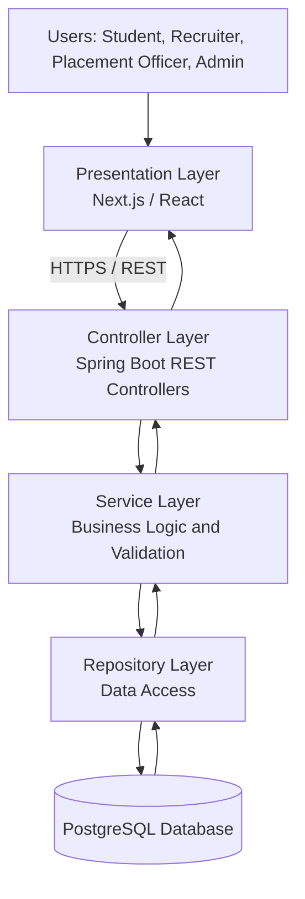

# Experiment 14: Final Project Design Review

## 1. Aim

To conduct a final design review of the Student Placement Management System by reviewing the Software Requirements Specification (SRS), UML diagrams, system architecture, and testing documentation, following industry software review practices.

## 2. Objectives

- To review the completeness and consistency of the SRS.
- To validate the UML use case, class, sequence, and activity diagrams.
- To evaluate the proposed system architecture.
- To review functional, integration, and performance testing documentation.
- To identify design risks, inconsistencies, and areas for improvement.
- To prepare a consolidated Final Design and Testing Report.

## 3. Project Overview

The Student Placement Management System is a proposed web application designed to centralize campus placement activities.

The system aims to support:

- Student registration and profile management.
- Resume management.
- Placement drive creation and publication.
- Student eligibility verification.
- Placement application submission and tracking.
- Recruiter application review and shortlisting.
- Interview scheduling and result management.
- Placement offer tracking and reporting.

The purpose of this review is to assess whether the documented design is sufficiently clear, consistent, testable, and ready to guide implementation.

**Proposed Technology Stack**

- Frontend: Next.js / React
- Backend: Java and Spring Boot
- Database: PostgreSQL
- API Communication: REST over HTTPS
- Testing: JUnit, manual test cases, Postman, and Apache JMeter
- Version Control and Project Tracking: GitHub and GitHub Projects

*Note: This is a design review of the proposed system. It does not claim that all features have been implemented, tested, or approved.*

## 4. Review of Software Requirements Specification (SRS)

### 4.1 Purpose of SRS Review

The SRS defines the system's functional requirements, non-functional requirements, interfaces, constraints, and acceptance criteria.

The review checks whether the requirements are clear, consistent, complete enough for implementation, and verifiable through testing.

### 4.2 Functional Requirements Review

| Requirement Area | Review Observation | Recommendation |
|---|---|---|
| User Registration | Registration behavior and user details should be defined clearly. | Specify mandatory fields, uniqueness constraints, and validation rules. |
| Authentication | Login and access control are essential. | Define authentication, password handling, session/token behavior, and error responses. |
| Student Profile | Profile management is a core feature. | Specify editable fields and profile completeness rules. |
| Placement Drives | Drive creation and publication need defined rules. | Document required fields, publication status, and application deadlines. |
| Eligibility | Eligibility depends on drive criteria. | Define CGPA, academic, backlog, and other applicable criteria explicitly. |
| Applications | Application submission must be reliable. | Define duplicate prevention, deadline handling, and status transitions. |
| Interviews | Scheduling and results require controlled access. | Specify who can schedule interviews and update results. |
| Offers | Offer status must be tracked consistently. | Define offer states and permitted transitions. |
| Reports | Placement statistics should be accurate. | Specify report filters, data definitions, and authorized roles. |

### 4.3 Non-Functional Requirements Review

| Quality Attribute | Review Recommendation |
|---|---|
| Security | Enforce authentication, role-based authorization, server-side validation, and secure credential storage. |
| Performance | Define measurable response-time and throughput targets for specified workloads. |
| Reliability | Prevent duplicate applications and preserve consistent application data. |
| Maintainability | Separate controllers, business services, and data-access responsibilities. |
| Scalability | Design modular components and monitor actual bottlenecks before expanding the architecture. |
| Usability | Provide clear navigation, validation messages, and accessible interfaces. |
| Data Integrity | Apply appropriate database constraints and transaction boundaries. |
| Availability | Define the expected service availability and recovery requirements if needed. |

### 4.4 SRS Review Checklist

- [ ] Functional requirements have unique identifiers.
- [ ] Requirements are clear, consistent, and testable.
- [ ] User roles and permissions are specified.
- [ ] Business rules and eligibility conditions are documented.
- [ ] Non-functional requirements have measurable acceptance criteria where appropriate.
- [ ] External interfaces and error-handling behavior are defined.
- [ ] Requirements are mapped to relevant test cases.

The checklist should be marked complete only after the corresponding documentation has been reviewed.

## 5. UML Diagram Review

UML diagrams provide different views of the proposed system. Their purpose is to ensure that system behavior, domain entities, and component interactions are documented consistently.

### 5.1 Use Case Diagram Review

**Actors:**

- Student
- Recruiter
- Placement Officer
- Administrator

**Key use cases:**

- Register and log in.
- Manage student profile and resume.
- Browse placement drives.
- Check eligibility and apply.
- Review applications.
- Schedule interviews and record results.
- Track offers and generate reports.
- Manage users and system access.

**Review observations:**

1. Each use case should represent a meaningful user goal.
2. Actors should be connected only to operations they are authorized to perform.
3. Relationships such as `include` and `extend` should represent genuine behavioral dependencies.
4. The diagram should show a clearly labeled system boundary.

**Recommendation:** Use a standard UML use case diagram in Draw.io or StarUML if required by the evaluator. A Mermaid flowchart is useful for documentation but is not equivalent to every UML notation convention.

### 5.2 Class Diagram Review

The proposed domain model includes:

- `User`
- `Student`
- `Recruiter`
- `PlacementOfficer`
- `PlacementDrive`
- `Application`
- `Resume`
- `Interview`
- `Offer`

**Review observations:**

- Common user information should be modeled consistently.
- Specialized user roles should have clearly defined relationships to the base user model.
- Each application should reference the relevant student and placement drive.
- Interview records should be associated with the appropriate application.
- Offer records should be associated with the relevant student or application according to the final domain rules.
- Multiplicities should accurately represent the permitted number of related records.

**Recommendation:** Verify primary keys, unique constraints, relationship multiplicities, and lifecycle rules before implementing the database schema.

### 5.3 Sequence Diagram Review

The reviewed workflow is student application submission.

Expected interaction sequence:

1. The student selects a placement drive.
2. The frontend sends the application request.
3. The controller validates and forwards the request.
4. The application service checks eligibility and duplicate applications.
5. The repository persists the application when all checks pass.
6. The backend returns an appropriate response.

The sequence diagram should include alternative paths for ineligible students, duplicate applications, invalid requests, and persistence failures where relevant.

### 5.4 Activity Diagram Review

The activity diagram should represent the application workflow from authentication to final submission.

Key decision points include:

- Is authentication successful?
- Is the placement drive open?
- Is the student eligible?
- Does an application already exist?
- Was the application saved successfully?

Each decision should have labeled branches and a valid path to an appropriate outcome.

### 5.5 UML Review Summary

| Diagram | Review Focus | Expected Outcome |
|---|---|---|
| Use Case Diagram | Actors, use cases, authorization boundaries | Requirements and user goals are represented consistently |
| Class Diagram | Attributes, operations, relationships, multiplicities | Domain model is sufficiently clear for implementation |
| Sequence Diagram | Message order and alternate flows | Application interactions are understandable |
| Activity Diagram | Actions, decisions, and outcomes | Business workflow is represented correctly |

## 6. Architecture Validation

### 6.1 Proposed Architecture

The recommended initial architecture is a layered modular monolith.

### 6.2 Architecture Validation Criteria

| Criterion | Validation Question | Recommended Action |
|---|---|---|
| Separation of Concerns | Are UI, business logic, and persistence responsibilities separated? | Keep business rules in the service layer. |
| Security | Are restricted operations protected on the server? | Enforce authentication and role-based authorization. |
| Data Integrity | Can duplicate or inconsistent records be created? | Use transactions, database constraints, and appropriate validation. |
| Maintainability | Are modules organized by responsibility? | Separate student, placement, application, interview, and reporting functionality. |
| Testability | Can services and APIs be tested independently? | Use unit and integration tests with appropriate test dependencies. |
| Performance | Can critical workflows meet defined targets? | Measure response times and database behavior under representative workloads. |
| Scalability | Is the design unnecessarily complex for the current project? | Start with a modular monolith and evolve only when justified. |

### 6.3 Architecture Decision

A modular monolith is recommended for the initial version because it reduces deployment complexity while preserving clear module boundaries.

Microservices may be considered later if independent deployment, scaling requirements, or team ownership justify the additional operational overhead.

### 6.4 Architecture Risks

1. **Unclear module boundaries:** May create tightly coupled business logic.
2. **Inadequate authorization:** Could expose restricted student or recruiter information.
3. **Insufficient database constraints:** Could permit duplicate applications or inconsistent records.
4. **Unverified performance assumptions:** Could lead to bottlenecks under high usage.
5. **Premature architectural complexity:** Could increase maintenance effort without meaningful benefits.

These risks should be reviewed and mitigated during implementation.

## 7. Testing Documentation Review

### 7.1 Purpose

Testing documentation provides evidence that the application has been evaluated against its requirements.

The review checks test coverage, test-case quality, traceability, execution status, and the documentation of defects.

### 7.2 Testing Areas Reviewed

**Unit Testing**

- Tests individual methods and business rules.
- Uses JUnit for automated tests.
- Covers valid inputs, invalid inputs, and boundary conditions.

**Integration Testing**

- Tests controller, service, repository, and database interactions.
- Checks persistence, transaction behavior, and API responses.

**Functional Testing**

- Verifies registration, login, drive browsing, eligibility checks, application submission, and reporting.

**Performance Testing**

- Uses load testing to assess behavior under expected demand.
- Uses stress testing to identify degradation and system limits.
- Records response times, throughput, error rates, and resource utilization.

**Regression Testing**

- Re-runs relevant existing tests after changes.
- Checks that new features and bug fixes do not break previously working functionality.

### 7.3 Test Documentation Checklist

- [ ] Each major functional requirement maps to one or more test cases.
- [ ] Test cases contain preconditions, steps, test data, and expected results.
- [ ] Actual results are recorded after execution.
- [ ] Test statuses reflect the evidence: Pass, Fail, Blocked, or Not Executed.
- [ ] Defects have identifiers, severity, and resolution status.
- [ ] Relevant regression tests are identified.
- [ ] Performance results include workload configuration and measured outcomes.
- [ ] Test evidence is retained where required.

### 7.4 Requirement Traceability Matrix

| Requirement ID | Requirement | Related Test Cases | Review Status |
|---|---|---|---|
| FR-01 | Student registration | TC-03, TC-04 | To Be Verified |
| FR-02 | User authentication | TC-01, TC-02 | To Be Verified |
| FR-03 | View placement drives | TC-05 | To Be Verified |
| FR-04 | Eligibility verification | TC-06, TC-07 | To Be Verified |
| FR-05 | Application submission | TC-06, TC-08 | To Be Verified |
| FR-06 | Drive administration | TC-09, TC-10 | To Be Verified |
| FR-07 | Application review | TC-11 | To Be Verified |
| FR-08 | Placement reporting | TC-12 | To Be Verified |

*The identifiers above should be reconciled with the final SRS and test case document. Requirement coverage cannot be considered complete until the mapping has been checked against the actual requirements.*

## 8. Consolidated Design Review Findings

The following findings are proposed review observations based on the documented design. They are not claims of a completed formal review or actual test execution.

| ID | Finding | Priority | Recommended Action |
|---|---|---|---|
| DR-01 | Requirement traceability must be verified across the SRS and test cases. | High | Maintain consistent requirement and test identifiers. |
| DR-02 | Eligibility rules need precise definitions. | High | Document all applicable criteria and boundary cases. |
| DR-03 | Role-based authorization is essential. | High | Define permissions and test unauthorized operations. |
| DR-04 | Application uniqueness must be enforced reliably. | High | Add appropriate database constraints and transaction handling. |
| DR-05 | UML relationships must match the domain model. | Medium | Verify multiplicities, inheritance, and lifecycle rules. |
| DR-06 | Performance targets require validation. | Medium | Run controlled tests and record actual measurements. |
| DR-07 | Architecture should avoid premature microservices. | Medium | Begin with a modular monolith and reassess as needs evolve. |
| DR-08 | Test execution evidence is required before claiming readiness. | High | Execute relevant tests and document actual results. |

## 9. Review Process and Approval Criteria

A practical software design review can follow these steps:

1. **Preparation:** Collect the SRS, UML diagrams, architecture diagram, and testing documents.
2. **Individual Review:** Inspect each artifact for correctness, consistency, and completeness.
3. **Review Meeting:** Discuss unclear requirements, design risks, and conflicting assumptions.
4. **Issue Recording:** Document findings with unique identifiers, priorities, and owners.
5. **Remediation:** Update requirements, diagrams, or implementation plans.
6. **Verification:** Confirm that the identified issues have been addressed.
7. **Approval:** Record reviewer names, date, decision, and any remaining limitations.

### Proposed Review Decision

The design should be considered **ready for implementation planning only after the high-priority findings are resolved or explicitly accepted**.

The final review record should distinguish among:

- Approved.
- Approved with conditions.
- Changes required.
- Not reviewed.

The actual decision must be recorded by the project reviewer or evaluator.

## 10. Industry Mapping: Software Review Process

Software Review Process refers to the systematic examination of requirements, designs, code, and testing artifacts to detect defects early and improve quality.

| Industry Practice | Application in the Project |
|---|---|
| Requirements Review | Checking SRS clarity and testability |
| Design Review | Inspecting UML diagrams and architecture decisions |
| Traceability | Linking requirements, design elements, and test cases |
| Risk-Based Review | Prioritizing security, eligibility, and data-integrity risks |
| Peer Review | Asking teammates to inspect diagrams and technical decisions |
| Defect Tracking | Recording findings, owners, and resolutions |
| Test Readiness Review | Verifying test coverage and environment readiness |
| Approval and Sign-Off | Recording the final review decision and outstanding risks |

## 11. Expected Outcomes

After completing this experiment, the following outcomes are expected:

- A consolidated review of the SRS.
- A documented review of UML diagrams.
- An assessment of the proposed architecture.
- A checklist for reviewing testing documentation.
- A requirement traceability matrix.
- A prioritized list of design findings and recommended actions.
- A structured review process aligned with industry practices.

## 12. Conclusion

This experiment consolidated the design and testing documentation of the proposed Student Placement Management System. The review covered the SRS, UML models, layered architecture, testing strategy, requirement traceability, and design risks.

A systematic software review helps identify inconsistencies before implementation, improves communication among team members, and establishes clear criteria for evaluating software quality and readiness.

The proposed modular monolith, clearly defined requirements, consistent UML diagrams, and traceable testing documentation provide a practical foundation for the next development stage.

## 13. Result

The Final Design and Testing Report was prepared for the Student Placement Management System. It includes review checklists, architecture validation criteria, a requirement traceability matrix, proposed design findings, and an industry-aligned software review process.

The report documents a proposed review framework. Final approval and implementation readiness must be established through actual artifact inspection, issue resolution, and recorded review decisions.
