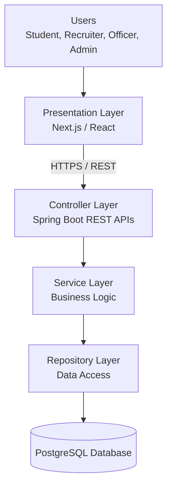

# Experiment 15: Final Project Demonstration and Viva

## 1. Aim

To present the Student Placement Management System, explain its software requirements and design, demonstrate its proposed architecture and testing approach, and prepare final project documentation following industry practices for client demonstrations and technical presentations.

## 2. Objectives

- To present the purpose and major features of the project.
- To explain the Software Requirements Specification (SRS).
- To demonstrate and explain the UML diagrams.
- To describe the system architecture and component interactions.
- To present functional, unit, integration, and performance testing documentation.
- To prepare for technical viva questions.
- To understand industry practices for client demonstrations and technical presentations.

## 3. Project Overview

### 3.1 Project Title

**Student Placement Management System**

### 3.2 Problem Statement

Many campus placement activities involve maintaining student information, publishing placement opportunities, verifying eligibility, managing applications, scheduling interviews, and tracking placement outcomes.

When these activities rely heavily on manual coordination or disconnected tools, they can become difficult to track and maintain consistently.

The Student Placement Management System is proposed as a centralized web application to organize these activities and provide role-appropriate access to students, recruiters, placement officers, and administrators.

### 3.3 Proposed Solution

The system aims to provide:

- Student registration and profile management.
- Resume management.
- Placement drive creation and publication.
- Eligibility verification.
- Application submission and status tracking.
- Recruiter application review and shortlisting.
- Interview scheduling and result management.
- Offer tracking and placement reports.

### 3.4 Proposed Technology Stack

| Component | Technology | Purpose |
|---|---|---|
| Frontend | Next.js / React | User interface |
| Backend | Java and Spring Boot | Business logic and REST APIs |
| Database | PostgreSQL | Persistent application data |
| API Communication | REST over HTTPS | Frontend-backend communication |
| Unit Testing | JUnit | Testing individual components |
| API Testing | Postman | Manual API verification |
| Performance Testing | Apache JMeter | Load and stress testing |
| Version Control | Git and GitHub | Source-code and documentation management |

*These technologies describe the proposed solution. Features and tools should be presented as implemented only after they have actually been developed or used.*

## 4. Software Requirements Specification (SRS)

### 4.1 Purpose

The SRS defines the functional and non-functional requirements of the Student Placement Management System. It provides a common reference for development, testing, and project evaluation.

### 4.2 Actors

1. **Student:** Manages a profile, views placement drives, checks eligibility, and applies.
2. **Recruiter:** Reviews relevant applications and participates in candidate selection.
3. **Placement Officer:** Manages placement drives, coordinates interviews, and views reports.
4. **Administrator:** Manages users, roles, and system-level access.

### 4.3 Functional Requirements

- User registration and authentication.
- Role-based access control.
- Student profile and resume management.
- Placement drive creation and publication.
- Eligibility verification.
- Application submission and tracking.
- Application review and shortlisting.
- Interview scheduling and results.
- Offer management.
- Placement reporting.

### 4.4 Non-Functional Requirements

- **Security:** Protect user information and restrict unauthorized access.
- **Performance:** Define and verify response-time targets under specified workloads.
- **Reliability:** Prevent duplicate applications and preserve data consistency.
- **Maintainability:** Separate business logic, request handling, and data access.
- **Usability:** Provide clear navigation and understandable error messages.
- **Scalability:** Support future growth without unnecessary architectural complexity.

## 5. UML Model Explanation

UML diagrams describe different views of the proposed system.

### 5.1 Use Case Diagram

**Purpose:** Shows the interactions between actors and system functionality.

Key use cases include:

- Register and log in.
- Manage student profile.
- Browse placement drives.
- Check eligibility.
- Apply for a placement drive.
- Review applications.
- Schedule interviews.
- Track offers.
- Generate placement reports.

**Viva explanation:** The use case diagram shows what the system provides to each type of user, not the internal implementation details.

### 5.2 Class Diagram

**Purpose:** Describes the static structure of the system, including classes, attributes, operations, and relationships.

Proposed classes:

- `User`
- `Student`
- `Recruiter`
- `PlacementOfficer`
- `PlacementDrive`
- `Application`
- `Resume`
- `Interview`
- `Offer`

**Viva explanation:** The class diagram represents the domain model. For example, an application connects a student with a placement drive and maintains the application's status.

### 5.3 Sequence Diagram

**Purpose:** Shows the order of messages exchanged between components during a particular workflow.

For application submission:

1. The student initiates an application.
2. The frontend sends the request to the controller.
3. The service checks eligibility and duplicate submissions.
4. The repository saves the application when the checks pass.
5. The backend returns the result.

**Viva explanation:** A sequence diagram focuses on the time-ordered interactions between participants.

### 5.4 Activity Diagram

**Purpose:** Represents the workflow and decision points of a process.

For application submission, the flow includes authentication, drive selection, eligibility verification, duplicate checking, submission, and success or failure outcomes.

**Viva explanation:** An activity diagram explains the sequence of activities and alternative paths in a business process.

### 5.5 Difference Between UML Diagrams

| Diagram | Main Focus |
|---|---|
| Use Case Diagram | User goals and system functionality |
| Class Diagram | Static structure and relationships |
| Sequence Diagram | Time-ordered interactions |
| Activity Diagram | Workflow and decision paths |

## 6. System Architecture Walkthrough

### 6.1 Proposed Architecture

The initial system uses a layered modular monolith design.

### 6.2 Layer Responsibilities

**Presentation Layer:** Displays pages, forms, placement drives, and application status.

**Controller Layer:** Receives HTTP requests, validates request structures, and returns responses.

**Service Layer:** Implements business rules such as eligibility verification and application processing.

**Repository Layer:** Handles database queries and persistence.

**Database Layer:** Stores users, student profiles, placement drives, applications, interviews, and offers.

### 6.3 Example Architecture Walkthrough

When a student applies for a placement drive:

1. The student selects a drive in the frontend.
2. The frontend sends an HTTP request to the Spring Boot API.
3. The controller validates the request and delegates
