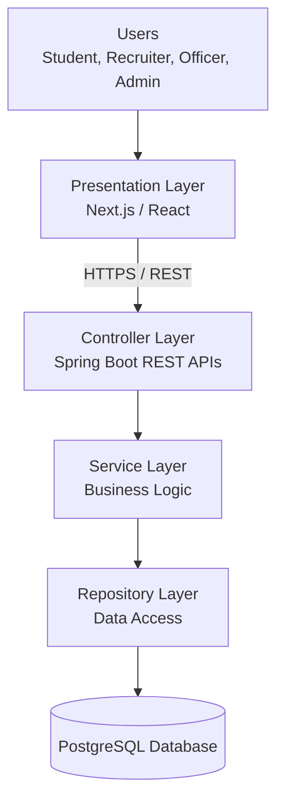

# Experiment 15: Final Project Demonstration and Viva

## 1. Aim

To present the Student Placement Management System, explain its software requirements and design, demonstrate its proposed architecture and testing approach, and prepare final project documentation following industry practices for client demonstrations and technical presentations.

## 2. Objectives

- To present the purpose and major features of the project.
- To explain the Software Requirements Specification (SRS).
- To demonstrate and explain the UML diagrams.
- To describe the system architecture and component interactions.
- To present functional, unit, integration, and performance testing documentation.
- To prepare for technical viva questions.
- To understand industry practices for client demonstrations and technical presentations.

## 3. Project Overview

### 3.1 Project Title

**Student Placement Management System**

### 3.2 Problem Statement

Many campus placement activities involve maintaining student information, publishing placement opportunities, verifying eligibility, managing applications, scheduling interviews, and tracking placement outcomes.

When these activities rely heavily on manual coordination or disconnected tools, they can become difficult to track and maintain consistently.

The Student Placement Management System is proposed as a centralized web application to organize these activities and provide role-appropriate access to students, recruiters, placement officers, and administrators.

### 3.3 Proposed Solution

The system aims to provide:

- Student registration and profile management.
- Resume management.
- Placement drive creation and publication.
- Eligibility verification.
- Application submission and status tracking.
- Recruiter application review and shortlisting.
- Interview scheduling and result management.
- Offer tracking and placement reports.

### 3.4 Proposed Technology Stack

| Component | Technology | Purpose |
|---|---|---|
| Frontend | Next.js / React | User interface |
| Backend | Java and Spring Boot | Business logic and REST APIs |
| Database | PostgreSQL | Persistent application data |
| API Communication | REST over HTTPS | Frontend-backend communication |
| Unit Testing | JUnit | Testing individual components |
| API Testing | Postman | Manual API verification |
| Performance Testing | Apache JMeter | Load and stress testing |
| Version Control | Git and GitHub | Source-code and documentation management |

*These technologies describe the proposed solution. Features and tools should be presented as implemented only after they have actually been developed or used.*

## 4. Software Requirements Specification (SRS)

### 4.1 Purpose

The SRS defines the functional and non-functional requirements of the Student Placement Management System. It provides a common reference for development, testing, and project evaluation.

### 4.2 Actors

1. **Student:** Manages a profile, views placement drives, checks eligibility, and applies.
2. **Recruiter:** Reviews relevant applications and participates in candidate selection.
3. **Placement Officer:** Manages placement drives, coordinates interviews, and views reports.
4. **Administrator:** Manages users, roles, and system-level access.

### 4.3 Functional Requirements

- User registration and authentication.
- Role-based access control.
- Student profile and resume management.
- Placement drive creation and publication.
- Eligibility verification.
- Application submission and tracking.
- Application review and shortlisting.
- Interview scheduling and results.
- Offer management.
- Placement reporting.

### 4.4 Non-Functional Requirements

- **Security:** Protect user information and restrict unauthorized access.
- **Performance:** Define and verify response-time targets under specified workloads.
- **Reliability:** Prevent duplicate applications and preserve data consistency.
- **Maintainability:** Separate business logic, request handling, and data access.
- **Usability:** Provide clear navigation and understandable error messages.
- **Scalability:** Support future growth without unnecessary architectural complexity.

## 5. UML Model Explanation

UML diagrams describe different views of the proposed system.

### 5.1 Use Case Diagram

**Purpose:** Shows the interactions between actors and system functionality.

Key use cases include:

- Register and log in.
- Manage student profile.
- Browse placement drives.
- Check eligibility.
- Apply for a placement drive.
- Review applications.
- Schedule interviews.
- Track offers.
- Generate placement reports.

**Viva explanation:** The use case diagram shows what the system provides to each type of user, not the internal implementation details.

### 5.2 Class Diagram

**Purpose:** Describes the static structure of the system, including classes, attributes, operations, and relationships.

Proposed classes:

- `User`
- `Student`
- `Recruiter`
- `PlacementOfficer`
- `PlacementDrive`
- `Application`
- `Resume`
- `Interview`
- `Offer`

**Viva explanation:** The class diagram represents the domain model. For example, an application connects a student with a placement drive and maintains the application's status.

### 5.3 Sequence Diagram

**Purpose:** Shows the order of messages exchanged between components during a particular workflow.

For application submission:

1. The student initiates an application.
2. The frontend sends the request to the controller.
3. The service checks eligibility and duplicate submissions.
4. The repository saves the application when the checks pass.
5. The backend returns the result.

**Viva explanation:** A sequence diagram focuses on the time-ordered interactions between participants.

### 5.4 Activity Diagram

**Purpose:** Represents the workflow and decision points of a process.

For application submission, the flow includes authentication, drive selection, eligibility verification, duplicate checking, submission, and success or failure outcomes.

**Viva explanation:** An activity diagram explains the sequence of activities and alternative paths in a business process.

### 5.5 Difference Between UML Diagrams

| Diagram | Main Focus |
|---|---|
| Use Case Diagram | User goals and system functionality |
| Class Diagram | Static structure and relationships |
| Sequence Diagram | Time-ordered interactions |
| Activity Diagram | Workflow and decision paths |

## 6. System Architecture Walkthrough

### 6.1 Proposed Architecture

The initial system uses a layered modular monolith design.

### 6.2 Layer Responsibilities

**Presentation Layer:** Displays pages, forms, placement drives, and application status.

**Controller Layer:** Receives HTTP requests, validates request structures, and returns responses.

**Service Layer:** Implements business rules such as eligibility verification and application processing.

**Repository Layer:** Handles database queries and persistence.

**Database Layer:** Stores users, student profiles, placement drives, applications, interviews, and offers.

### 6.3 Example Architecture Walkthrough

When a student applies for a placement drive:

1. The student selects a drive in the frontend.
2. The frontend sends an HTTP request to the Spring Boot API.
3. The controller validates the request and delegates processing.
4. The service checks eligibility and whether an application already exists.
5. The repository interacts with PostgreSQL to save the application.
6. The backend returns a response.
7. The frontend displays the outcome.

### 6.4 Why Use a Modular Monolith?

- Simpler initial development and deployment.
- Clear separation of responsibilities.
- Easier local testing and debugging.
- Lower operational complexity than microservices.
- Ability to introduce independent services later if real requirements justify them.

## 7. Testing Reports and Demonstration

### 7.1 Unit Testing

Unit tests verify individual methods or components.

Example: Testing whether a student meets a minimum CGPA criterion.

| Input CGPA | Minimum CGPA | Expected Result |
|---:|---:|---|
| 8.2 | 7.0 | Eligible for the CGPA criterion |
| 7.0 | 7.0 | Eligible for the CGPA criterion |
| 6.5 | 7.0 | Not eligible |

### 7.2 Integration Testing

Integration tests verify interactions between components, such as:

- Controller and service.
- Service and repository.
- Repository and database.
- Authentication and authorization.

### 7.3 Functional Testing

Functional tests verify registration, login, drive browsing, eligibility checks, application submission, and reporting.

### 7.4 Performance Testing

Load testing measures performance under an expected workload. Stress testing increases workload beyond the expected operating level to identify degradation and limits.

Useful metrics include:

- Response time.
- Throughput.
- Error rate.
- CPU and memory utilization.
- p95 and p99 response times.

### 7.5 Testing Demonstration Checklist

- [ ] Show the documented test cases.
- [ ] Demonstrate a valid workflow if implemented.
- [ ] Demonstrate an invalid-input or authorization scenario if implemented.
- [ ] Show actual JUnit test results, if tests have been run.
- [ ] Show actual API test results, if available.
- [ ] Present JMeter measurements only if a performance test has been executed.
- [ ] Explain any known defects or incomplete features honestly.

**Important:** The test scenarios above describe expected behavior. They should not be presented as successful execution results without supporting evidence.

## 8. Final Project Demonstration Plan

A short demonstration can follow this sequence:

| Step | Demonstration | Purpose |
|---|---|---|
| 1 | Introduce the problem statement | Explain why the system is needed |
| 2 | Present the SRS and actors | Establish requirements and user roles |
| 3 | Explain the use case diagram | Show system functionality |
| 4 | Explain the class diagram | Show domain entities and relationships |
| 5 | Present the architecture diagram | Explain component responsibilities |
| 6 | Demonstrate implemented features | Show actual system behavior |
| 7 | Present testing documentation | Explain test coverage and results |
| 8 | Discuss limitations and future scope | Show awareness of remaining work |

If a feature is not implemented, present its design or prototype clearly rather than describing it as a working feature.

## 9. Final Documentation Checklist

The final submission should include:

- [ ] Project title and problem statement.
- [ ] Software Requirements Specification.
- [ ] Functional and non-functional requirements.
- [ ] Use case diagram.
- [ ] Class diagram.
- [ ] Sequence diagram.
- [ ] Activity diagram.
- [ ] System architecture diagram.
- [ ] Test case document.
- [ ] Unit and integration testing documentation.
- [ ] Functional and performance testing report.
- [ ] Agile backlog or Sprint Board evidence.
- [ ] Design review findings.
- [ ] Final conclusion and future scope.

## 10. Future Scope

Possible future enhancements include:

- Automated notifications for placement updates.
- More detailed placement analytics.
- Integration with external recruitment platforms.
- Improved resume management.
- Advanced audit logging.
- Performance optimization based on measured bottlenecks.
- Microservices adoption if justified by future scale and deployment needs.

These are proposed enhancements, not current system capabilities unless implemented.

## 11. Industry Mapping: Client Demo and Technical Presentation

Industry project demonstrations communicate business value, technical decisions, evidence of functionality, limitations, and future plans to stakeholders.

| Industry Practice | Application in the Project |
|---|---|
| Problem Presentation | Explain the placement-management problem |
| Requirement Review | Present the SRS and user roles |
| Technical Walkthrough | Explain UML models and architecture |
| Live Demonstration | Show implemented features using realistic test data |
| Quality Evidence | Present actual test results and known defects |
| Stakeholder Communication | Use clear explanations and answer questions |
| Risk Communication | Disclose limitations and unresolved issues |
| Documentation Handover | Submit the SRS, design documents, and testing reports |

### Presentation Guidelines

1. Start with the problem and intended users.
2. Explain the solution before discussing implementation details.
3. Use diagrams to make technical concepts understandable.
4. Demonstrate only verified functionality.
5. Explain why the chosen architecture is appropriate.
6. Present testing evidence accurately.
7. Acknowledge limitations and explain practical next steps.

## 12. Viva Questions and Answers

**Q1. What is the Student Placement Management System?**

It is a proposed web application that centralizes student profiles, placement drives, applications, interviews, offers, and placement reporting.

**Q2. What is an SRS?**

A Software Requirements Specification documents the system's functional and non-functional requirements, interfaces, constraints, and expected behavior.

**Q3. Why is UML used?**

UML helps visualize and communicate system structure, behavior, interactions, and workflows.

**Q4. What is the difference between a class diagram and a sequence diagram?**

A class diagram shows the static structure of classes and their relationships. A sequence diagram shows time-ordered interactions between participants.

**Q5. Why is layered architecture useful?**

It separates responsibilities, making the application easier to understand, test, and maintain.

**Q6. Why is a modular monolith recommended initially?**

It offers clear module boundaries without the deployment and communication overhead of multiple independent services.

**Q7. What is unit testing?**

Unit testing checks an individual method or component independently.

**Q8. What is integration testing?**

Integration testing checks whether multiple components work correctly together.

**Q9. What is regression testing?**

Regression testing verifies that existing functionality continues to work after changes.

**Q10. What is load testing?**

Load testing measures application behavior under a specified expected workload.

**Q11. What is stress testing?**

Stress testing pushes the system beyond its expected operating workload to identify limits and failure behavior.

**Q12. How can duplicate applications be prevented?**

The system can check for an existing application and enforce an appropriate database uniqueness constraint, with transaction-safe handling of concurrent requests.

**Q13. What is the purpose of a Scrum board?**

A Scrum board helps visualize Sprint Backlog work and track its progress.

**Q14. What would you improve in the project in the future?**

I would prioritize security, requirement traceability, automated testing, performance measurement, and improvements based on stakeholder feedback.

**Q15. How do you know the project is ready for release?**

Readiness should be based on agreed acceptance criteria, completed required functionality, relevant test evidence, resolved or accepted risks, and stakeholder approval.

## 13. Conclusion

This experiment consolidates the final project documentation and prepares the Student Placement Management System for a structured technical presentation and viva.

The report reviews requirements, UML models, architecture, testing documentation, and industry presentation practices. It also provides a demonstration plan and viva questions to support clear communication of the proposed design.

## 14. Result

The Final Project Documentation was prepared for the Student Placement Management System, including an SRS summary, UML model explanations, architecture walkthrough, testing review, demonstration checklist, and viva preparation material.

Actual implementation status, test results, and final approval should be documented using verified project evidence.
