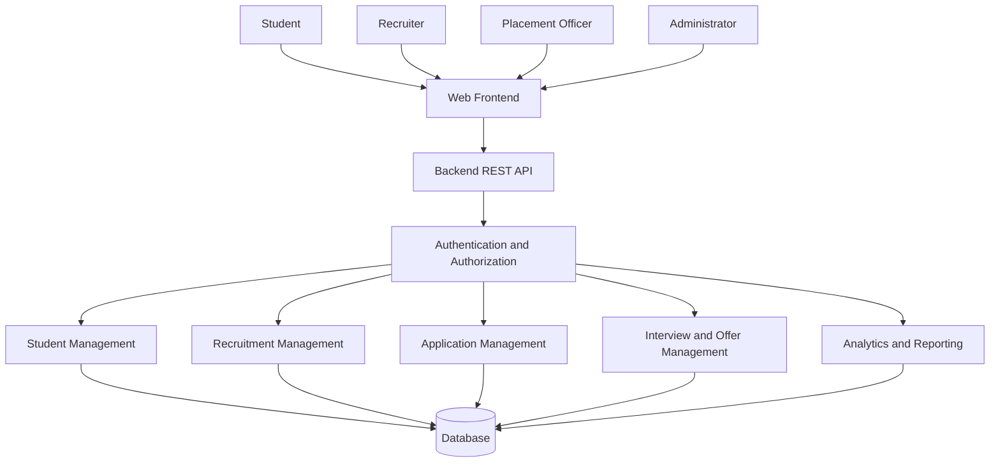

# EXPERIMENT 4: SOFTWARE REQUIREMENTS SPECIFICATION (SRS)

## Project: Student Placement Management System

---

## 1. Aim

To prepare a Software Requirements Specification (SRS) document for the Student Placement Management System using the IEEE-style documentation structure, defining the functional requirements, non-functional requirements, system interfaces, constraints and overall system behaviour.

## 2. Objective

The objectives of this experiment are:

1. To understand the importance of SRS documentation in software development.
2. To identify and document the functional requirements of the proposed system.
3. To define non-functional requirements such as security, performance, reliability and maintainability.
4. To describe the overall system architecture, users and operating environment.
5. To establish a clear reference for software design, implementation and testing.
6. To follow a structured, industry-oriented software documentation approach.

---

# 3. Software Requirements Specification (SRS)

## 3.1 Introduction

### 3.1.1 Purpose

The purpose of this Software Requirements Specification document is to define the requirements of the Student Placement Management System.

The document describes the expected behaviour, features, interfaces, constraints and quality requirements of the system. It serves as a common reference for developers, testers, placement officers, students, recruiters and other stakeholders.

This document will guide the subsequent phases of software development, including system design, implementation, testing and maintenance.

### 3.1.2 Scope

The Student Placement Management System is a web-based application designed to manage and streamline the campus placement process.

The system provides a centralized platform for students to maintain their profiles, upload resumes, explore placement opportunities and track applications. Recruiters can manage placement drives, review applications and shortlist candidates. Placement officers can monitor placement activities and access relevant reports.

The proposed system may also include AI-assisted resume analysis, candidate-job matching and skill-gap analysis as future or optional enhancements.

The major functionalities within the scope of the system are:

- Student registration and profile management.
- Recruiter and company profile management.
- Placement drive creation and management.
- Eligibility verification.
- Job application management.
- Candidate shortlisting.
- Interview scheduling.
- Offer and placement tracking.
- Placement statistics and reporting.
- Secure authentication and role-based authorization.

### 3.1.3 Definitions, Acronyms and Abbreviations

| Term | Description |
|---|---|
| SRS | Software Requirements Specification |
| SPMS | Student Placement Management System |
| UI | User Interface |
| API | Application Programming Interface |
| DBMS | Database Management System |
| JWT | JSON Web Token |
| RBAC | Role-Based Access Control |
| AI | Artificial Intelligence |
| CRUD | Create, Read, Update and Delete |
| SQL | Structured Query Language |
| REST | Representational State Transfer |
| NFR | Non-Functional Requirement |
| FR | Functional Requirement |

### 3.1.4 References

The following references provide guidance for preparing this document:

1. IEEE Std 830-1998, Recommended Practice for Software Requirements Specifications.
2. ISO/IEC/IEEE 29148, Systems and Software Engineering — Life Cycle Processes — Requirements Engineering.
3. Sommerville, Ian, *Software Engineering*.
4. Course material on Software Engineering and Design Principles.

*Note: This document follows a conventional IEEE-style SRS structure for academic purposes; it is not claimed to be formally certified as compliant with a specific standard.*

### 3.1.5 Document Overview

This document is organized into the following sections:

- **Section 1:** Introduction and purpose.
- **Section 2:** Overall system description.
- **Section 3:** Functional requirements.
- **Section 4:** External interface requirements.
- **Section 5:** Non-functional requirements.
- **Section 6:** System constraints and assumptions.
- **Section 7:** Acceptance criteria.

---

# 3.2 Overall Description

## 3.2.1 Product Perspective

The Student Placement Management System is proposed as a centralized web application that connects students, recruiters and the college placement department.

It is intended to replace fragmented manual processes and provide a structured workflow for placement-related activities.

The system follows a modular architecture in which different modules handle authentication, student management, recruitment, applications, interviews, offers and analytics.

### High-Level System Architecture

## 3.2.2 Product Functions

The major functions of the system are:

1. User registration and authentication.
2. Student profile and resume management.
3. Recruiter and company management.
4. Placement drive creation and publication.
5. Eligibility checking based on predefined criteria.
6. Application submission and tracking.
7. Candidate shortlisting and status management.
8. Interview scheduling and tracking.
9. Offer management.
10. Placement analytics and report generation.
11. Role-based access control.
12. Optional AI-assisted resume and candidate analysis.

## 3.2.3 User Classes and Characteristics

| User Class | Description | Responsibilities |
|---|---|---|
| Student | A registered student seeking placement opportunities | Manage profile, upload resume, apply for drives and track progress |
| Recruiter | An authorized company representative | Create placement drives, review candidates and manage recruitment |
| Placement Officer | College placement department representative | Monitor drives, verify information and manage placement activities |
| Administrator | Authorized system manager | Manage users, permissions and system configuration |

### User Characteristics

- Students should be able to use the system with basic computer and internet knowledge.
- Recruiters should be familiar with recruitment requirements and candidate selection.
- Placement officers should understand college placement procedures.
- Administrators should understand user management and system configuration.

## 3.2.4 Operating Environment

The proposed system will operate in the following environment:

| Component | Proposed Technology |
|---|---|
| Operating System | Windows, Linux or macOS |
| Frontend | Next.js and React |
| Backend | Java and Spring Boot |
| Database | PostgreSQL |
| Authentication | Spring Security and JWT |
| Caching | Redis, if implemented |
| Messaging | Apache Kafka, if implemented |
| AI Integration | Spring AI, if implemented |
| File Storage | Local storage during development or cloud storage such as AWS S3 |
| Deployment | Docker and a cloud platform, when configured |
| Browser | Modern browsers such as Chrome, Firefox and Edge |

## 3.2.5 Design and Implementation Constraints

The system is subject to the following constraints:

1. Users must have an internet connection to access the hosted application.
2. Users must authenticate before accessing protected features.
3. Access to system functions must depend on assigned roles.
4. The application must maintain data consistency during placement operations.
5. Student information and resumes must be protected from unauthorized access.
6. Eligibility rules must be defined before placement drives are published.
7. The application must use compatible frontend, backend and database technologies.
8. AI-related functionality depends on the availability and configuration of the selected AI model or provider.
9. External services may introduce availability, latency and cost limitations.
10. The initial implementation should remain manageable within the project's available time and resources.

## 3.2.6 User Documentation

The following documentation may be provided:

- User guide for students.
- Recruiter usage guide.
- Placement officer guide.
- Administrator guide.
- API documentation for developers.
- Installation and deployment instructions.
- Troubleshooting documentation.

## 3.2.7 Assumptions and Dependencies

The system is based on the following assumptions:

1. Students provide accurate academic and personal information.
2. Recruiters provide valid company and job information.
3. Placement officers define the applicable placement rules.
4. Users have access to a supported web browser.
5. The hosting environment and database are available when the application is accessed.
6. Email or notification services, if integrated, are available.
7. AI services, if enabled, have valid configuration and access credentials.
8. The college has authority to manage the placement information maintained by the system.

---

# 3.3 Functional Requirements

Functional requirements describe what the system must do.

## FR-01: User Registration

**Description:** The system shall allow eligible users to create an account.

**Inputs:**
- Name
- Email address
- Password
- User role
- Other required registration details

**Expected Behaviour:**
- Validate the submitted information.
- Check whether the email address is already registered.
- Store the account securely.
- Display a success or error message.

**Priority:** High.

## FR-02: User Authentication

**Description:** The system shall authenticate registered users before granting access to protected functionality.

**Inputs:**
- Email address or username
- Password

**Expected Behaviour:**
- Verify the supplied credentials.
- Reject invalid credentials.
- Establish an authenticated session or issue an authentication token.
- Restrict access to protected endpoints.

**Priority:** High.

## FR-03: Student Profile Management

**Description:** The system shall allow students to create and update their profiles.

**Expected Behaviour:**
- Store personal and academic information.
- Allow students to update permitted fields.
- Validate required information.
- Display the current profile.
- Prevent unauthorized modification of another student's profile.

**Priority:** High.

## FR-04: Resume Management

**Description:** The system shall allow students to upload and manage resumes.

**Expected Behaviour:**
- Accept supported resume file formats.
- Validate file type and file size.
- Store the resume securely.
- Allow authorized users to access the resume.
- Allow students to replace an outdated resume.

**Priority:** High.

## FR-05: Recruiter Management

**Description:** The system shall allow authorized recruiters to maintain company information.

**Expected Behaviour:**
- Create and update recruiter profiles.
- Maintain company details.
- Associate placement drives with the appropriate recruiter.
- Restrict recruiter access to authorized operations.

**Priority:** High.

## FR-06: Placement Drive Management

**Description:** The system shall allow authorized recruiters or placement officers to create and manage placement drives.

**Required Information:**
- Company name
- Job title
- Job description
- Required skills
- Minimum CGPA, where applicable
- Eligible branches
- Graduation year
- Application deadline
- Other selection criteria

**Expected Behaviour:**
- Create and update placement drives.
- Publish or close drives.
- Display active drives to eligible users.
- Prevent applications after the applicable deadline.
- Restrict drive management to authorized users.

**Priority:** High.

## FR-07: Eligibility Verification

**Description:** The system shall determine whether a student satisfies the eligibility criteria of a placement drive.

**Expected Behaviour:**
- Compare student academic information against the configured criteria.
- Check eligible branches and graduation year.
- Check the minimum CGPA when specified.
- Display eligibility status to the student.
- Prevent ineligible applications where the drive rules require it.

**Priority:** High.

## FR-08: Application Management

**Description:** The system shall allow eligible students to apply for placement drives.

**Expected Behaviour:**
- Accept applications for active placement drives.
- Associate each application with the relevant student and drive.
- Record the application timestamp.
- Prevent duplicate applications to the same drive, according to system policy.
- Display application status.
- Restrict application information to authorized users.

**Priority:** High.

## FR-09: Candidate Shortlisting

**Description:** The system shall allow authorized recruiters to review and shortlist candidates.

**Expected Behaviour:**
- Display applications associated with the recruiter's placement drive.
- Allow authorized status updates.
- Record the application status.
- Make the updated status visible to permitted users.
- Maintain an appropriate history of status changes.

**Priority:** High.

## FR-10: Interview Management

**Description:** The system shall allow authorized users to schedule and manage interviews.

**Expected Behaviour:**
- Schedule interview dates and times.
- Record interview mode and other required details.
- Associate the interview with the relevant application.
- Allow authorized updates or cancellations.
- Display interview information to the relevant student and recruiter.

**Priority:** Medium.

## FR-11: Offer Management

**Description:** The system shall support the management of offers made to selected candidates.

**Expected Behaviour:**
- Record offer details.
- Associate an offer with the relevant application.
- Allow authorized users to update offer status.
- Allow the student to view the offer information.
- Record acceptance or rejection when supported by the workflow.

**Priority:** Medium.

## FR-12: Placement Analytics

**Description:** The system shall provide placement-related summaries and reports to authorized placement officers.

**Expected Behaviour:**
- Display the number of registered students.
- Display active placement drives.
- Summarize application and selection statistics.
- Display placement outcomes.
- Apply access restrictions to reports containing sensitive information.

**Priority:** Medium.

## FR-13: Notifications

**Description:** The system should notify users about relevant placement activities when a notification service is configured.

**Expected Behaviour:**
- Notify students about application status changes.
- Notify users about interview schedules.
- Notify selected candidates about offers.
- Avoid sending notifications to unauthorized recipients.

**Priority:** Medium.

## FR-14: AI-Assisted Resume Analysis

**Description:** The system may analyze resumes to identify relevant skills and experience.

**Expected Behaviour:**
- Extract supported resume text.
- Identify relevant skills and projects.
- Provide an analysis based on the available information.
- Allow users to review the results.
- Avoid treating AI output as a guaranteed or final hiring decision.

**Priority:** Optional / Future Enhancement.

## FR-15: AI-Assisted Candidate Matching

**Description:** The system may compare candidate profiles against job requirements.

**Expected Behaviour:**
- Analyze relevant candidate and job information.
- Identify matching and missing skills.
- Present a match summary.
- Allow recruiters to make the final selection decision.

**Priority:** Optional / Future Enhancement.

## FR-16: User and Role Administration

**Description:** The system shall allow authorized administrators to manage users and their access permissions.

**Expected Behaviour:**
- View and manage user accounts.
- Assign or update permitted roles.
- Disable accounts when necessary.
- Restrict administrative operations to authorized administrators.
- Maintain audit records for important administrative actions where supported.

**Priority:** High.

---

# 3.4 External Interface Requirements

## 3.4.1 User Interface Requirements

The user interface shall:

1. Provide a clear and consistent layout.
2. Display navigation options appropriate to the user's role.
3. Provide forms for registration and profile management.
4. Display placement drives and application statuses.
5. Show meaningful validation and error messages.
6. Provide suitable dashboards for students, recruiters and placement officers.
7. Support commonly used desktop and mobile browser sizes.
8. Avoid exposing sensitive information to unauthorized users.

## 3.4.2 Software Interface Requirements

| Interface | Purpose |
|---|---|
| Next.js / React Frontend | Provides user-facing screens |
| Spring Boot REST API | Processes application requests |
| PostgreSQL | Stores structured application data |
| Spring Security | Handles authentication and authorization |
| Redis | Optional caching of frequently accessed data |
| Apache Kafka | Optional asynchronous event processing |
| Spring AI | Optional integration with AI models |
| AWS S3 | Optional storage of resumes and documents |

## 3.4.3 Communication Interface Requirements

1. The frontend and backend shall communicate through HTTP-based REST APIs.
2. HTTPS shall be used in production deployments.
3. API requests and responses shall use an appropriate structured format, such as JSON.
4. Authentication information shall be transmitted securely.
5. Invalid requests shall return appropriate error responses.
6. External services shall be accessed through configured interfaces.

## 3.4.4 Hardware Interface Requirements

The system does not require specialized hardware.

Users need a computer, laptop, tablet or smartphone capable of running a supported browser and accessing the application.

The hosting environment must provide sufficient computing, memory, storage and network resources for the deployed workload.

---

# 3.5 Non-Functional Requirements

Non-functional requirements define the quality attributes and operational expectations of the system.

## NFR-01: Performance

- Common API requests should normally complete within 2 seconds under the defined normal test workload, excluding slow external services.
- The system should avoid unnecessary database queries.
- Frequently accessed data may be cached where appropriate.
- Large lists should support pagination.

**Verification:** Measure API response times under a documented test workload.

## NFR-02: Security

- Protected functionality shall require authentication.
- Role-based authorization shall restrict access to permitted operations.
- Passwords shall be stored using an appropriate password-hashing algorithm.
- Sensitive information shall not be exposed through unauthorized APIs.
- Production traffic shall use HTTPS.
- Uploaded files shall be validated before storage or processing.
- Secrets and API keys shall not be committed to the source repository.

**Verification:** Perform authentication, authorization and input-validation tests.

## NFR-03: Reliability

- The system should handle invalid inputs without crashing.
- Database operations should preserve data consistency.
- Errors should be logged appropriately.
- Failed operations should return meaningful error responses.
- Important placement records should not be silently lost.

**Verification:** Execute error-handling and database consistency tests.

## NFR-04: Availability

- The deployed system should be accessible whenever the hosting environment and required dependencies are operational.
- Temporary service failures should be handled gracefully.
- Appropriate health checks and monitoring should be introduced for production deployment.

**Verification:** Conduct availability and service-recovery checks.

## NFR-05: Scalability

- The application should support growth in students, recruiters, placement drives and applications.
- Database queries should be optimized for expected data volumes.
- The backend should be designed to support additional application instances if required.
- Caching and asynchronous processing may be introduced when justified by workload.

**Verification:** Perform load tests and evaluate system behaviour as request volume increases.

## NFR-06: Maintainability

- The application should follow modular and layered design principles.
- Business logic should be separated from controllers and persistence logic.
- Classes, methods and APIs should have meaningful names.
- Important modules should include appropriate documentation and tests.
- Configuration should be separated from application code.

**Verification:** Conduct code reviews and evaluate testability and module separation.

## NFR-07: Usability

- The interface should be understandable to users with basic computer knowledge.
- Forms should provide clear labels and validation messages.
- Important actions should provide appropriate feedback.
- Users should be able to locate placement opportunities and application information easily.

**Verification:** Conduct basic usability testing with representative users.

## NFR-08: Compatibility

- The web application should support current versions of major browsers.
- The interface should adapt to common desktop and mobile screen sizes.
- API communication should follow consistent request and response conventions.

**Verification:** Perform browser compatibility and responsive-layout testing.

## NFR-09: Data Integrity

- Each application shall reference a valid student and placement drive.
- Application status values shall follow the defined workflow.
- Database constraints shall be used where appropriate.
- Unauthorized users shall not be able to modify placement records.

**Verification:** Test database constraints, relationships and invalid state transitions.

## NFR-10: Privacy

- Student information shall only be accessible to authorized users.
- Resume documents shall not be publicly accessible by default.
- Personal data shall only be collected when required for system functionality.
- AI integrations shall follow the configured privacy and data-handling requirements.

**Verification:** Test access restrictions and document-storage permissions.

---

# 3.6 System Constraints

The following constraints apply to the proposed implementation:

1. The application will primarily be accessed through a web browser.
2. Backend implementation is planned using Java and Spring Boot.
3. PostgreSQL will serve as the primary relational database.
4. The frontend is planned using Next.js and React.
5. External integrations require valid configuration and credentials.
6. Advanced AI functionality may depend on model availability and processing costs.
7. Production performance will depend on infrastructure, database size and workload.
8. The project scope may be adjusted according to available development time and resources.

---

# 3.7 Use Case Summary

| Use Case ID | Use Case | Primary Actor |
|---|---|---|
| UC-01 | Register Account | Student / Recruiter |
| UC-02 | Log In | All Registered Users |
| UC-03 | Manage Student Profile | Student |
| UC-04 | Upload Resume | Student |
| UC-05 | Create Placement Drive | Recruiter / Placement Officer |
| UC-06 | View Placement Drives | Student |
| UC-07 | Check Eligibility | Student / System |
| UC-08 | Apply for Placement Drive | Student |
| UC-09 | Shortlist Candidate | Recruiter |
| UC-10 | Schedule Interview | Recruiter / Placement Officer |
| UC-11 | Manage Offers | Recruiter / Placement Officer |
| UC-12 | View Placement Analytics | Placement Officer |
| UC-13 | Manage Users | Administrator |

---

# 3.8 Acceptance Criteria

The system will be considered ready for its initial release when the following criteria are satisfied:

1. Users can register and log in using valid credentials.
2. Protected features reject unauthorized requests.
3. Students can create and update their profiles.
4. Students can upload resumes using supported formats.
5. Authorized users can create and manage placement drives.
6. The system can evaluate configured eligibility criteria.
7. Eligible students can submit applications.
8. Duplicate applications are handled according to the defined policy.
9. Recruiters can review applications and update candidate status.
10. Interviews can be scheduled and viewed by authorized users.
11. Offers can be recorded and tracked.
12. Placement officers can access relevant placement summaries.
13. Invalid requests produce appropriate error responses.
14. Automated tests cover the major business workflows.
15. The application documentation describes the setup and intended functionality.

AI, Kafka, Redis and cloud deployment requirements will be evaluated when those optional components are implemented.

---

# 4. Conclusion

The Software Requirements Specification for the Student Placement Management System defines the functional and non-functional requirements of the proposed application.

It identifies the system's stakeholders, major features, operating environment, external interfaces, constraints and quality expectations.

This document provides a structured foundation for the next stages of software development, including UML modeling, database design, implementation and testing.

Preparing an SRS helps reduce ambiguity, improve communication among stakeholders and ensure that the developed system addresses the intended requirements.

---

# 5. Result

The IEEE-style Software Requirements Specification document for the Student Placement Management System was prepared successfully. The document defines the proposed system's scope, overall description, functional requirements, non-functional requirements, external interfaces, constraints and acceptance criteria.
