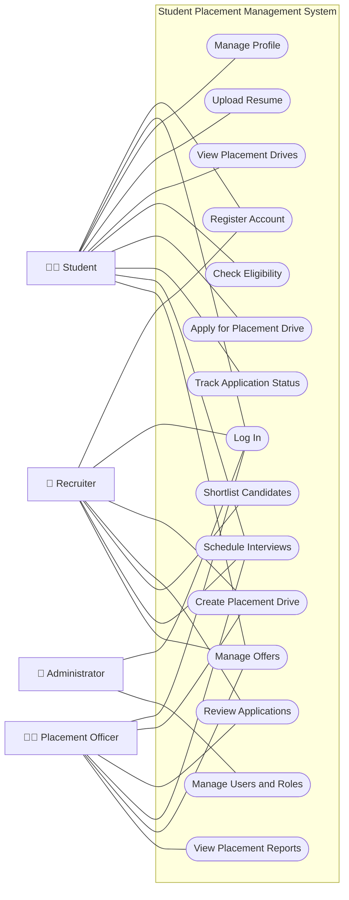
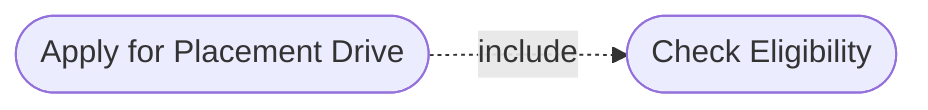
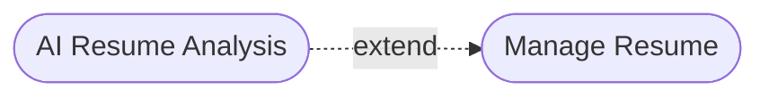

# EXPERIMENT 5: UML USE CASE MODELING

## Project: Student Placement Management System

---

## 1. Aim

To identify the use cases, create a UML Use Case Diagram, and prepare detailed use case descriptions for the Student Placement Management System.

## 2. Objectives

1. To identify the actors interacting with the system.
2. To identify the major use cases of the application.
3. To represent the functional requirements using a UML Use Case Diagram.
4. To understand the relationships between actors and use cases.
5. To prepare structured use case descriptions.
6. To apply requirement modeling techniques used in industry.

## 3. Tools Required

- Draw.io (diagrams.net) / StarUML
- GitHub for documentation
- Mermaid for text-based diagram representation

---

# 4. Introduction

The Student Placement Management System is a web-based application designed to manage the campus placement process.

The system provides functionalities for students, recruiters, placement officers and administrators. Students can manage profiles, upload resumes, view placement drives and apply for eligible opportunities. Recruiters can manage placement drives and review applications. Placement officers can monitor placement activities, while administrators manage users and system access.

UML Use Case Modeling represents the interactions between external actors and the functionalities provided by the system.

It helps define the system boundary, identify functional requirements and communicate system behaviour to developers, testers and stakeholders.

---

# 5. Actor Identification

An actor is a person or external system that interacts with the application to achieve a particular goal.

The following actors have been identified for the Student Placement Management System.

| Actor ID | Actor | Description |
|---|---|---|
| A1 | Student | Manages profile, uploads resume, views placement drives and submits applications. |
| A2 | Recruiter | Creates placement drives, reviews applications and shortlists candidates. |
| A3 | Placement Officer | Monitors placement activities and manages placement-related operations. |
| A4 | Administrator | Manages users, roles and system configuration. |

## 5.1 Student

The Student is the primary user who accesses the system to participate in campus placements.

Responsibilities:
- Register and log in.
- Manage personal and academic information.
- Upload and update resumes.
- View available placement drives.
- Check eligibility.
- Apply for placement opportunities.
- Track application status.
- View interview schedules and offers.

## 5.2 Recruiter

The Recruiter represents an authorized company representative responsible for recruitment activities.

Responsibilities:
- Manage company information.
- Create placement drives.
- Specify eligibility criteria.
- Review student applications.
- Shortlist candidates.
- Schedule interviews.
- Manage candidate selection and offers.

## 5.3 Placement Officer

The Placement Officer manages and monitors the college placement process.

Responsibilities:
- Monitor student placement activities.
- Manage placement drives.
- Verify placement-related information.
- Monitor application and selection status.
- Coordinate placement activities.
- View placement reports and statistics.

## 5.4 Administrator

The Administrator is responsible for system-level management.

Responsibilities:
- Manage user accounts.
- Assign and manage user roles.
- Control access permissions.
- Configure system settings.
- Monitor important administrative activities.

---

# 6. Use Case Identification

A use case describes a specific function or service that the system provides to an actor.

The major use cases identified for the application are listed below.

| Use Case ID | Use Case Name | Primary Actor |
|---|---|---|
| UC-01 | Register Account | Student / Recruiter |
| UC-02 | Log In | All Registered Users |
| UC-03 | Manage Student Profile | Student |
| UC-04 | Upload Resume | Student |
| UC-05 | View Placement Drives | Student |
| UC-06 | Check Eligibility | Student |
| UC-07 | Apply for Placement Drive | Student |
| UC-08 | Track Application Status | Student |
| UC-09 | Create Placement Drive | Recruiter |
| UC-10 | Review Applications | Recruiter |
| UC-11 | Shortlist Candidates | Recruiter |
| UC-12 | Schedule Interviews | Recruiter / Placement Officer |
| UC-13 | Manage Offers | Recruiter / Placement Officer |
| UC-14 | View Placement Reports | Placement Officer |
| UC-15 | Manage Users and Roles | Administrator |

---

# 7. UML Use Case Diagram

## 7.1 Description

The Use Case Diagram represents the functional interactions between the actors and the Student Placement Management System.

The system boundary encloses the use cases provided by the application. Actors are placed outside the boundary because they interact with the system externally.

The diagram illustrates:
- The actors interacting with the application.
- The major functionalities provided by the system.
- Associations between actors and use cases.
- The relationship between application submission and eligibility checking.

## 7.2 Use Case Diagram

**Note:** The diagram is a text-based representation of the use case model. It can be recreated using standard UML actor symbols, use case ovals and a system boundary in Draw.io or StarUML.

---

# 8. Use Case Relationships

UML use case diagrams may use relationships such as association, `include` and `extend`.

## 8.1 Association

An association connects an actor with a use case and represents interaction between them.

Examples:
- Student — Apply for Placement Drive.
- Recruiter — Shortlist Candidates.
- Placement Officer — View Placement Reports.
- Administrator — Manage Users and Roles.

## 8.2 Include Relationship

The `include` relationship represents required behaviour that is reused by another use case.

For this application:

- **Apply for Placement Drive** includes **Check Eligibility**.

Eligibility checking is a required step before an application is accepted.

## 8.3 Extend Relationship

The `extend` relationship represents optional or conditional behaviour that may occur under a defined condition.

For example, AI-assisted resume analysis could optionally extend the resume management workflow if the feature is implemented.

**Note:** These relationships are conceptual examples. The final UML model should reflect the actual application requirements and implemented workflows.

---

# 9. Use Case Description Template

Each use case is documented using a standard template to describe its purpose, participants, preconditions, main flow, alternative flows and postconditions.

The following fields are used:

| Field | Description |
|---|---|
| Use Case ID | Unique identifier |
| Use Case Name | Name of the functionality |
| Primary Actor | Main user interacting with the system |
| Goal | Objective of the actor |
| Preconditions | Conditions that must hold before execution |
| Trigger | Event that initiates the use case |
| Main Flow | Normal sequence of steps |
| Alternative Flow | Other possible execution paths |
| Exceptions | Error or failure conditions |
| Postconditions | State of the system after execution |

---

# 10. Detailed Use Case Descriptions

## UC-01: Register Account

**Primary Actor:** Student / Recruiter

**Goal:** Create a new account in the system.

**Preconditions:**
- The user can access the application.
- The user does not already have an account with the same registered email address.

**Trigger:** The user selects the registration option.

### Main Flow

1. The user opens the registration page.
2. The system displays the registration form.
3. The user enters the required details.
4. The system validates the submitted information.
5. The system checks whether the email address is already registered.
6. The system securely stores the account information.
7. The system displays a registration success message.

### Alternative Flow

- If the submitted details are invalid, the system displays validation errors.
- If the email address is already registered, the system asks the user to use another address or log in.

**Exceptions:**
- Database or server failure.
- Invalid or incomplete registration data.

**Postconditions:**
- A valid account is created, or an appropriate error message is displayed.

---

## UC-02: Log In

**Primary Actor:** Registered User

**Goal:** Access authorized system functionalities.

**Preconditions:**
- The user has a registered account.
- The application is available.

**Trigger:** The user submits the login form.

### Main Flow

1. The user opens the login page.
2. The user enters their credentials.
3. The system validates the credentials.
4. The system authenticates the user.
5. The system establishes an authenticated session or issues an authentication token.
6. The system redirects the user to the appropriate dashboard.

### Alternative Flow

- If the credentials are incorrect, the system displays an error message.
- If the account is disabled, access is denied.

**Exceptions:**
- Authentication service unavailable.
- Unexpected server error.

**Postconditions:**
- The user is authenticated and can access authorized functionality.

---

## UC-03: Manage Student Profile

**Primary Actor:** Student

**Goal:** Maintain accurate personal and academic information.

**Preconditions:**
- The student is authenticated.

**Trigger:** The student opens the profile section.

### Main Flow

1. The student opens the profile page.
2. The system displays the existing profile information.
3. The student adds or updates the permitted fields.
4. The student submits the changes.
5. The system validates the data.
6. The system saves the updated information.
7. The system displays a success message.

### Alternative Flow

- If required fields are missing, the system requests the missing information.
- If a field contains invalid data, the system displays a validation message.

**Exceptions:**
- Database failure.
- Unauthorized profile modification attempt.

**Postconditions:**
- The profile is updated with valid information.

---

## UC-04: Upload Resume

**Primary Actor:** Student

**Goal:** Upload a resume for placement applications.

**Preconditions:**
- The student is authenticated.
- The student has a supported resume file.

**Trigger:** The student selects the resume upload option.

### Main Flow

1. The student opens the resume management page.
2. The student selects a resume file.
3. The system validates the file type and size.
4. The system stores the resume securely.
5. The system associates the resume with the student's account.
6. The system confirms successful upload.

### Alternative Flow

- If the file format is unsupported, the system rejects the upload.
- If the file exceeds the permitted size, the system displays an error.
- If a previous resume exists, the student may replace it according to system policy.

**Exceptions:**
- File storage failure.
- Network interruption.

**Postconditions:**
- The resume is stored and associated with the student's profile.

---

## UC-05: View Placement Drives

**Primary Actor:** Student

**Goal:** Discover available placement opportunities.

**Preconditions:**
- The student is authenticated.

**Trigger:** The student opens the placement drives page.

### Main Flow

1. The student navigates to placement drives.
2. The system retrieves active placement drives.
3. The system displays drive details.
4. The student views company information and eligibility criteria.
5. The student selects a drive for further details.

### Alternative Flow

- If no active drives exist, the system displays an appropriate message.
- If a drive is closed, the system marks it as unavailable for new applications.

**Exceptions:**
- Database or server failure.

**Postconditions:**
- The student can view available placement opportunities.

---

## UC-06: Check Eligibility

**Primary Actor:** Student / System

**Goal:** Determine whether the student satisfies a placement drive's criteria.

**Preconditions:**
- The student is authenticated.
- The placement drive exists and has defined eligibility rules.
- The student profile contains the required information.

**Trigger:** The student selects an eligibility check or attempts to apply.

### Main Flow

1. The system retrieves the student's academic details.
2. The system retrieves the placement drive's eligibility criteria.
3. The system compares the student's details with the criteria.
4. The system determines the eligibility status.
5. The system displays the result to the student.

### Alternative Flow

- If profile information is incomplete, the system asks the student to update the profile.
- If the student does not satisfy the criteria, the system displays the applicable reason.

**Exceptions:**
- Missing eligibility rules.
- Database failure.

**Postconditions:**
- The eligibility result is available to guide the application process.

---

## UC-07: Apply for Placement Drive

**Primary Actor:** Student

**Goal:** Submit an application for an eligible placement opportunity.

**Preconditions:**
- The student is authenticated.
- The placement drive is active.
- The student satisfies the applicable eligibility criteria.
- The application deadline has not passed.

**Trigger:** The student selects the Apply option.

### Main Flow

1. The student opens the placement drive.
2. The system checks the student's eligibility.
3. The system checks whether the student has already applied.
4. The system displays the application details.
5. The student confirms the application.
6. The system records the application.
7. The system assigns an initial application status.
8. The system displays a confirmation message.

### Alternative Flow

- If the student is ineligible, the application is rejected.
- If the student has already applied, duplicate submission is prevented.
- If the deadline has passed, the system does not accept the application.

**Exceptions:**
- Database transaction failure.
- Unexpected server error.

**Postconditions:**
- A valid application is recorded and can be tracked by authorized users.

---

## UC-08: Track Application Status

**Primary Actor:** Student

**Goal:** View the progress of submitted applications.

**Preconditions:**
- The student is authenticated.
- At least one application exists, or the student is accessing the application tracking page.

**Trigger:** The student opens the application dashboard.

### Main Flow

1. The student opens the application tracking page.
2. The system retrieves the student's applications.
3. The system displays the associated placement drives.
4. The system displays the current status of each application.
5. The student selects an application to view its details.

### Alternative Flow

- If no applications exist, the system displays an appropriate message.

**Exceptions:**
- Database failure.
- Unauthorized access to another student's applications.

**Postconditions:**
- The student can view the status of their own applications.

---

## UC-09: Create Placement Drive

**Primary Actor:** Recruiter

**Goal:** Publish a placement opportunity for eligible students.

**Preconditions:**
- The recruiter is authenticated and authorized.
- Required company and placement information is available.

**Trigger:** The recruiter selects Create Placement Drive.

### Main Flow

1. The recruiter opens the placement drive management page.
2. The system displays a form.
3. The recruiter enters job details and eligibility criteria.
4. The recruiter submits the form.
5. The system validates the information.
6. The system stores the placement drive.
7. The system publishes the drive according to its status.
8. The system displays a confirmation message.

### Alternative Flow

- If required information is missing, the system displays validation errors.
- If the recruiter is not authorized, the operation is denied.

**Exceptions:**
- Database failure.
- Invalid placement drive information.

**Postconditions:**
- A placement drive is created and available according to its publication status.

---

## UC-10: Review Applications

**Primary Actor:** Recruiter

**Goal:** Review applications submitted for a placement drive.

**Preconditions:**
- The recruiter is authenticated.
- The recruiter is authorized to access the relevant drive.
- Applications have been submitted.

**Trigger:** The recruiter opens the applications section.

### Main Flow

1. The recruiter selects a placement drive.
2. The system retrieves the associated applications.
3. The system displays permitted candidate information.
4. The recruiter reviews application details.
5. The recruiter identifies candidates for further consideration.

### Alternative Flow

- If no applications exist, the system displays an appropriate message.
- If the recruiter lacks access to the drive, the system denies access.

**Exceptions:**
- Data retrieval failure.
- Unauthorized access attempt.

**Postconditions:**
- The recruiter can review the applications for authorized placement drives.

---

## UC-11: Shortlist Candidates

**Primary Actor:** Recruiter

**Goal:** Mark suitable applicants for the next recruitment stage.

**Preconditions:**
- The recruiter is authenticated.
- The recruiter has access to the relevant applications.

**Trigger:** The recruiter selects a candidate and updates the application status.

### Main Flow

1. The recruiter opens an application.
2. The system displays the relevant candidate information.
3. The recruiter reviews the application.
4. The recruiter selects the appropriate status.
5. The system validates the requested transition.
6. The system saves the updated status.
7. The system makes the updated status available to authorized users.

### Alternative Flow

- If the requested status transition is invalid, the system rejects the update.
- If the recruiter lacks permission, the operation is denied.

**Exceptions:**
- Database update failure.

**Postconditions:**
- The application status is updated when the operation is valid and authorized.

---

## UC-12: Schedule Interviews

**Primary Actor:** Recruiter / Placement Officer

**Goal:** Schedule an interview for a candidate.

**Preconditions:**
- The actor is authenticated and authorized.
- The relevant application exists.
- The candidate is eligible for the interview stage.

**Trigger:** The actor selects Schedule Interview.

### Main Flow

1. The actor opens the relevant application.
2. The actor enters the interview date, time, mode and other required details.
3. The system validates the interview information.
4. The system records the interview.
5. The system associates the interview with the application.
6. The system makes the schedule available to authorized users.

### Alternative Flow

- If the interview details are invalid, the system requests corrections.
- If the application is not eligible for interview scheduling, the system rejects the operation.

**Exceptions:**
- Database failure.
- Scheduling conflict, if conflict checking is supported.

**Postconditions:**
- The interview is scheduled and linked to the relevant application.

---

## UC-13: Manage Offers

**Primary Actor:** Recruiter / Placement Officer

**Goal:** Record and track offers made to selected candidates.

**Preconditions:**
- The actor is authenticated and authorized.
- The relevant application exists.
- The candidate has reached the applicable offer stage.

**Trigger:** The actor creates or updates an offer.

### Main Flow

1. The actor opens the relevant application.
2. The actor enters the offer details.
3. The system validates the information.
4. The system records the offer.
5. The system associates the offer with the application.
6. The system allows the authorized student to view the offer.

### Alternative Flow

- If the offer details are invalid, the system displays an error.
- If the application is not eligible for an offer, the system rejects the operation.

**Exceptions:**
- Database failure.
- Unauthorized offer modification.

**Postconditions:**
- The offer is recorded and its status can be tracked.

---

## UC-14: View Placement Reports

**Primary Actor:** Placement Officer

**Goal:** Monitor placement activities and review placement statistics.

**Preconditions:**
- The placement officer is authenticated and authorized.

**Trigger:** The placement officer opens the analytics dashboard.

### Main Flow

1. The placement officer opens the reports section.
2. The system retrieves relevant placement information.
3. The system calculates or retrieves placement statistics.
4. The system displays the reports.
5. The placement officer reviews the information.

### Alternative Flow

- If no placement data exists, the system displays an appropriate message.
- If data retrieval fails, the system reports the error.

**Exceptions:**
- Database failure.
- Unauthorized report access.

**Postconditions:**
- The placement officer can review the available placement reports.

---

## UC-15: Manage Users and Roles

**Primary Actor:** Administrator

**Goal:** Manage user accounts and access permissions.

**Preconditions:**
- The administrator is authenticated.
- The administrator has the required privileges.

**Trigger:** The administrator opens the user management section.

### Main Flow

1. The administrator opens user management.
2. The system displays permitted user records.
3. The administrator selects a user.
4. The administrator performs an authorized action.
5. The system validates the action.
6. The system updates the account or role information.
7. The system confirms the operation.

### Alternative Flow

- If the user does not exist, the system displays an error.
- If the requested operation is not permitted, the system denies access.

**Exceptions:**
- Database update failure.
- Unauthorized administrative action.

**Postconditions:**
- The requested user management operation is completed if valid and authorized.

---

# 11. Relationship Between Requirements and Use Cases

Use cases provide a user-oriented view of the functional requirements described in the SRS document.

| Functional Requirement | Related Use Cases |
|---|---|
| FR-01: User Registration | UC-01 |
| FR-02: User Authentication | UC-02 |
| FR-03: Student Profile Management | UC-03 |
| FR-04: Resume Management | UC-04 |
| FR-05: Recruiter Management | UC-09, UC-10 |
| FR-06: Placement Drive Management | UC-05, UC-09 |
| FR-07: Eligibility Verification | UC-06, UC-07 |
| FR-08: Application Management | UC-07, UC-08, UC-10 |
| FR-09: Candidate Shortlisting | UC-11 |
| FR-10: Interview Management | UC-12 |
| FR-11: Offer Management | UC-13 |
| FR-12: Placement Analytics | UC-14 |
| FR-16: User and Role Administration | UC-15 |

---

# 12. Advantages of Use Case Modeling

1. Clearly identifies the system's actors.
2. Defines the system boundary.
3. Describes functional requirements from the user's perspective.
4. Improves communication among stakeholders.
5. Helps identify missing functionalities.
6. Provides a foundation for test-case development.
7. Supports requirement validation.
8. Improves traceability between requirements and system behaviour.

---

# 13. Industry Mapping: Requirement Modeling

Use Case Modeling is widely used during requirements analysis and software design.

It helps business analysts, developers, testers and clients understand how users interact with a proposed system.

In an industry environment, use cases can be used to:

- Clarify business requirements.
- Define system boundaries.
- Identify actors and user goals.
- Review requirements with stakeholders.
- Derive functional test cases.
- Support system design and development planning.
- Trace requirements to implementation and testing.

For the Student Placement Management System, the use case model provides a common understanding of placement workflows for students, recruiters, placement officers and administrators.

---

# 14. Conclusion

The UML Use Case Model for the Student Placement Management System was prepared by identifying the primary actors, defining the major use cases and documenting their interactions with the system.

Detailed use case descriptions were prepared to explain preconditions, triggers, main flows, alternative flows, exceptions and postconditions.

The model provides a structured representation of the application's functional requirements and serves as a foundation for subsequent software design and testing activities.

---

# 15. Result

The experiment was completed successfully. The actors and use cases of the Student Placement Management System were identified, a text-based Use Case Diagram was created, and detailed use case narratives were documented.
