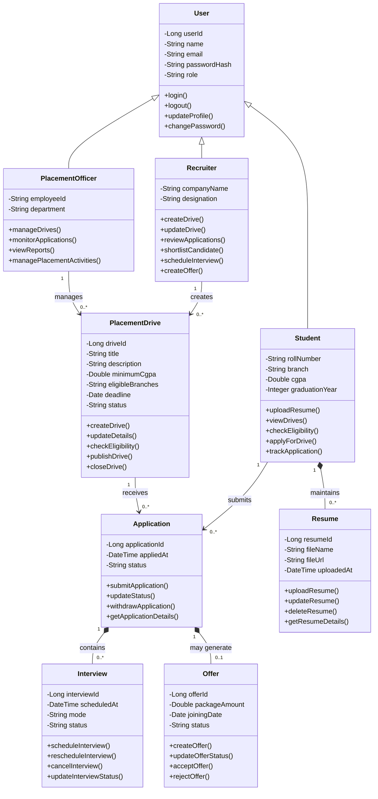

# EXPERIMENT 6: UML – CLASS DIAGRAM DESIGN

## Project: Student Placement Management System

---

## 1. Aim

To perform Object-Oriented Analysis, identify the major classes, their attributes and methods, establish relationships between classes, and design a UML Class Diagram for the Student Placement Management System.

## 2. Objectives

1. To understand the fundamentals of Object-Oriented Analysis.
2. To identify the major classes required for the system.
3. To define suitable attributes and methods for each class.
4. To identify relationships such as association, inheritance, aggregation and composition.
5. To represent the static structure of the system using a UML Class Diagram.
6. To understand how class diagrams support object-oriented system design.

## 3. Tools Required

- Draw.io (diagrams.net) / StarUML
- Mermaid for text-based UML diagrams
- GitHub for documentation

---

# 4. Introduction

The Student Placement Management System is a web-based application designed to manage the campus placement process.

The system allows students to maintain their profiles, upload resumes, explore placement opportunities and submit applications. Recruiters can create placement drives, review applications and shortlist candidates. Placement officers can monitor placement activities, while administrators manage users and system access.

Object-Oriented Analysis (OOA) is the process of identifying the objects, classes, properties and behaviours required to represent a real-world problem.

A UML Class Diagram represents the static structure of a system by showing its classes, attributes, methods and relationships.

For this project, the class diagram provides a blueprint for implementing the application's domain model using an object-oriented programming language such as Java.

---

# 5. Object-Oriented Analysis

Object-Oriented Analysis focuses on identifying the real-world entities involved in the system and understanding their responsibilities.

For the Student Placement Management System, the main entities include:

- User
- Student
- Recruiter
- PlacementOfficer
- PlacementDrive
- Application
- Interview
- Offer
- Resume

Each entity represents a concept in the placement domain.

For example, a Student maintains academic information and submits applications, while a PlacementDrive contains job details and eligibility criteria.

These entities are represented as classes with suitable attributes and methods.

## 5.1 Identification of Classes

| Class | Purpose |
|---|---|
| User | Represents common account information |
| Student | Represents a student seeking placement |
| Recruiter | Represents a company representative |
| PlacementOfficer | Represents the college placement coordinator |
| PlacementDrive | Represents a job or campus placement opportunity |
| Application | Represents a student's application to a placement drive |
| Resume | Represents a student's resume document |
| Interview | Represents an interview associated with an application |
| Offer | Represents an employment offer made to a candidate |

## 5.2 Identification of Attributes

Attributes represent the data maintained by an object.

Examples:

- `User`: userId, name, email, passwordHash, role
- `Student`: rollNumber, branch, cgpa, graduationYear
- `Recruiter`: companyName, designation
- `PlacementDrive`: title, description, minimumCgpa, deadline, status
- `Application`: applicationId, appliedAt, status
- `Resume`: resumeId, fileName, fileUrl, uploadedAt
- `Interview`: interviewId, scheduledAt, mode, status
- `Offer`: offerId, packageAmount, joiningDate, status

## 5.3 Identification of Methods

Methods represent the operations that objects can perform.

Examples:

- `User`: updateProfile(), changePassword()
- `Student`: uploadResume(), viewDrives(), applyForDrive()
- `Recruiter`: createDrive(), reviewApplications(), shortlistCandidate()
- `PlacementOfficer`: manageDrives(), viewReports()
- `PlacementDrive`: updateDetails(), checkEligibility()
- `Application`: updateStatus(), withdrawApplication()
- `Resume`: updateResume(), getResumeDetails()
- `Interview`: scheduleInterview(), rescheduleInterview()
- `Offer`: updateOfferStatus(), getOfferDetails()

---

# 6. UML Class Diagram

## 6.1 Description

The UML Class Diagram represents the static structure of the Student Placement Management System.

It contains the following elements:

1. **Classes:** Represent the major entities of the system.
2. **Attributes:** Represent the data stored by each class.
3. **Methods:** Represent the operations performed by each class.
4. **Inheritance:** Represents an "is-a" relationship between classes.
5. **Association:** Represents a relationship between classes.
6. **Composition:** Represents a strong whole-part relationship in which the part's lifecycle depends on the whole.

The diagram uses a common User class to represent shared account information. Student, Recruiter and PlacementOfficer inherit from User.

Applications connect students with placement drives, while interviews and offers are associated with applications.

## 6.2 Class Diagram



---

# 7. Class Descriptions

## 7.1 User Class

The User class represents the common information shared by registered users.

### Attributes

- `userId`: Unique identifier of the user.
- `name`: Full name of the user.
- `email`: Registered email address.
- `passwordHash`: Securely stored password hash.
- `role`: Role assigned to the user.

### Methods

- `login()`: Authenticates the user.
- `logout()`: Ends the authenticated session.
- `updateProfile()`: Updates permitted profile information.
- `changePassword()`: Changes the account password.

The User class acts as the parent class for Student, Recruiter and PlacementOfficer.

## 7.2 Student Class

The Student class represents students participating in campus placements.

### Attributes

- `rollNumber`: Unique student roll number.
- `branch`: Academic branch.
- `cgpa`: Current cumulative grade point average.
- `graduationYear`: Expected graduation year.

### Methods

- `uploadResume()`: Uploads or updates a resume.
- `viewDrives()`: Displays available placement drives.
- `checkEligibility()`: Checks eligibility for a drive.
- `applyForDrive()`: Submits an application.
- `trackApplication()`: Views application status.

## 7.3 Recruiter Class

The Recruiter class represents a company representative responsible for recruitment.

### Attributes

- `companyName`: Name of the company.
- `designation`: Recruiter's professional designation.

### Methods

- `createDrive()`: Creates a placement drive.
- `updateDrive()`: Updates placement drive information.
- `reviewApplications()`: Reviews candidate applications.
- `shortlistCandidate()`: Shortlists a candidate.
- `scheduleInterview()`: Arranges an interview.
- `createOffer()`: Creates an employment offer.

## 7.4 PlacementOfficer Class

The PlacementOfficer class represents the college placement coordinator.

### Attributes

- `employeeId`: Unique employee identifier.
- `department`: Department associated with the officer.

### Methods

- `manageDrives()`: Manages placement drives.
- `monitorApplications()`: Monitors applications.
- `viewReports()`: Views placement statistics.
- `managePlacementActivities()`: Coordinates placement activities.

## 7.5 PlacementDrive Class

The PlacementDrive class represents a job opportunity offered through the campus placement process.

### Attributes

- `driveId`: Unique drive identifier.
- `title`: Job title.
- `description`: Job description.
- `minimumCgpa`: Minimum CGPA criterion, where applicable.
- `eligibleBranches`: Branches eligible for the drive.
- `deadline`: Application deadline.
- `status`: Current drive status.

### Methods

- `createDrive()`: Creates a new placement drive.
- `updateDetails()`: Updates drive information.
- `checkEligibility()`: Evaluates eligibility criteria.
- `publishDrive()`: Publishes the drive.
- `closeDrive()`: Closes the drive.

## 7.6 Application Class

The Application class represents an application submitted by a student for a particular placement drive.

### Attributes

- `applicationId`: Unique application identifier.
- `appliedAt`: Date and time of submission.
- `status`: Current application status.

### Methods

- `submitApplication()`: Submits an application.
- `updateStatus()`: Updates the application status.
- `withdrawApplication()`: Withdraws an application when permitted.
- `getApplicationDetails()`: Retrieves application information.

## 7.7 Resume Class

The Resume class represents the resume document associated with a student's profile.

### Attributes

- `resumeId`: Unique resume identifier.
- `fileName`: Name of the uploaded file.
- `fileUrl`: Reference to the stored document.
- `uploadedAt`: Date and time of upload.

### Methods

- `uploadResume()`: Uploads a resume.
- `updateResume()`: Replaces an existing resume.
- `deleteResume()`: Removes a resume when permitted.
- `getResumeDetails()`: Retrieves resume metadata.

## 7.8 Interview Class

The Interview class represents an interview associated with a candidate's application.

### Attributes

- `interviewId`: Unique interview identifier.
- `scheduledAt`: Scheduled date and time.
- `mode`: Interview mode, such as online or offline.
- `status`: Current interview status.

### Methods

- `scheduleInterview()`: Schedules an interview.
- `rescheduleInterview()`: Changes the interview schedule.
- `cancelInterview()`: Cancels an interview.
- `updateInterviewStatus()`: Updates interview progress.

## 7.9 Offer Class

The Offer class represents an employment offer made to a selected candidate.

### Attributes

- `offerId`: Unique offer identifier.
- `packageAmount`: Offered compensation.
- `joiningDate`: Proposed joining date.
- `status`: Current offer status.

### Methods

- `createOffer()`: Records an employment offer.
- `updateOfferStatus()`: Updates offer status.
- `acceptOffer()`: Records offer acceptance.
- `rejectOffer()`: Records offer rejection.

---

# 8. Relationships Between Classes

## 8.1 Inheritance

Inheritance represents an "is-a" relationship.

In this system:

- Student is a User.
- Recruiter is a User.
- PlacementOfficer is a User.

The common attributes and methods are defined in User, while the child classes provide role-specific information and behaviour.

**UML notation:** A solid line with a hollow triangle pointing toward the parent class.

## 8.2 Association

Association represents a relationship between two classes.

Examples:

- A Student submits Applications.
- A PlacementDrive receives Applications.
- A Recruiter creates PlacementDrives.
- A PlacementOfficer manages PlacementDrives.

Associations show how objects interact with one another.

## 8.3 Composition

Composition represents a strong whole-part relationship.

In the proposed model:

- A Student maintains Resume records.
- An Application contains its Interview records and may generate an Offer.

The diagram uses composition where the associated record is intended to follow the lifecycle of its parent record.

**Design note:** If resumes, interviews or offers must be retained independently for audit purposes, their lifecycle and relationships should be modeled accordingly. Composition is a design decision, not a mandatory rule.

## 8.4 Multiplicity

Multiplicity specifies how many objects can participate in a relationship.

| Multiplicity | Meaning |
|---|---|
| `1` | Exactly one |
| `0..1` | Zero or one |
| `0..*` | Zero or many |
| `1..*` | One or many |

Examples:

- One Student can submit zero or many Applications.
- One PlacementDrive can receive zero or many Applications.
- One Recruiter can create zero or many PlacementDrives.
- One Application may generate zero or one Offer.

---

# 9. Object-Oriented Design Principles

The proposed class model applies the following object-oriented principles.

## 9.1 Encapsulation

Attributes are modeled as private fields, while operations are exposed through methods.

This helps control access to object state and enforce validation.

## 9.2 Inheritance

Student, Recruiter and PlacementOfficer inherit common user information from User.

This reduces duplication of shared account-related fields.

## 9.3 Abstraction

Each class represents a specific concept and exposes the operations relevant to that concept.

For example, the Application class handles application-related behaviour without requiring other classes to manage its internal details directly.

## 9.4 Modularity

The model separates different responsibilities into classes such as Student, PlacementDrive, Application, Interview and Offer.

This improves readability, testing and maintainability.

## 9.5 High Cohesion

Each class should focus on a closely related set of responsibilities.

For example, the Interview class manages interview-related information and operations.

## 9.6 Low Coupling

Classes should depend only on the information and behaviour they require.

In the implementation, service classes and interfaces can help keep business logic independent of controllers and persistence details.

---

# 10. Mapping the Class Diagram to Java

The UML model can be translated into Java classes.

For example, the Student class may be represented as follows:

```java
public class Student {

    private String rollNumber;
    private String branch;
    private Double cgpa;
    private Integer graduationYear;

    public void uploadResume() {
        // Resume upload logic
    }

    public void viewDrives() {
        // Placement drive retrieval logic
    }

    public boolean checkEligibility(PlacementDrive drive) {
        // Eligibility verification logic
        return false;
    }
}
```

The PlacementDrive class may be represented as follows:

```java
import java.time.LocalDate;

public class PlacementDrive {

    private Long driveId;
    private String title;
    private String description;
    private Double minimumCgpa;
    private String status;
    private LocalDate deadline;

    public void updateDetails() {
        // Update placement drive details
    }

    public void publishDrive() {
        // Publish placement drive
    }

    public void closeDrive() {
        // Close placement drive
    }
}
```

These examples illustrate how classes, attributes and methods from the UML model can be translated into Java. In a Spring Boot implementation, persistence annotations, constructors, validation and service-layer responsibilities would be added as required.

---

# 11. Industry Mapping: Object-Oriented System Design

Class Diagram modeling is widely used in software engineering to represent the static structure of object-oriented applications.

It helps developers and architects:

1. Identify the major domain entities.
2. Define responsibilities of individual classes.
3. Establish relationships and multiplicities.
4. Reduce duplication through appropriate inheritance.
5. Plan database entity relationships.
6. Guide implementation in object-oriented languages.
7. Improve communication between developers and stakeholders.
8. Support testing and long-term maintenance.

For the Student Placement Management System, the class diagram provides a blueprint for designing the domain model and implementing the backend using Java and Spring Boot.

---

# 12. Conclusion

The UML Class Diagram for the Student Placement Management System was designed after performing Object-Oriented Analysis.

The major classes, attributes, methods and relationships were identified and represented using UML notation.

The diagram demonstrates inheritance, association, composition and multiplicity. It provides a foundation for translating the system requirements into an object-oriented implementation.

---

# 13. Result

The experiment was completed successfully. The major classes of the Student Placement Management System were identified, their attributes and methods were defined, and a UML Class Diagram was prepared to represent the static structure and relationships of the proposed system.
