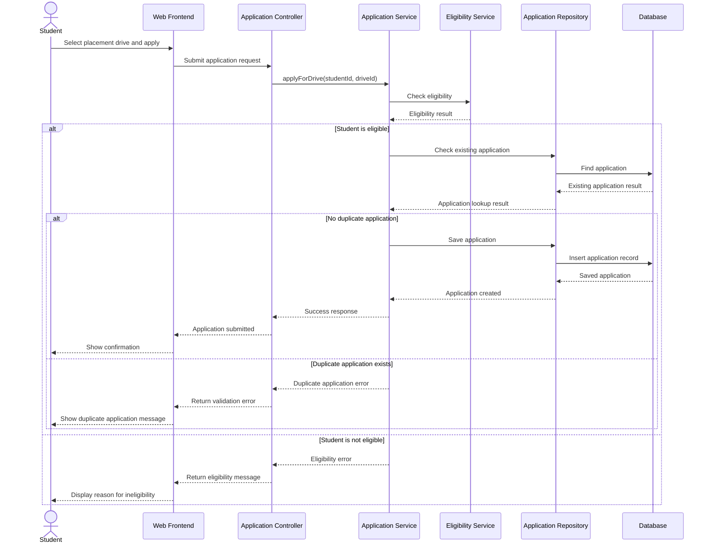
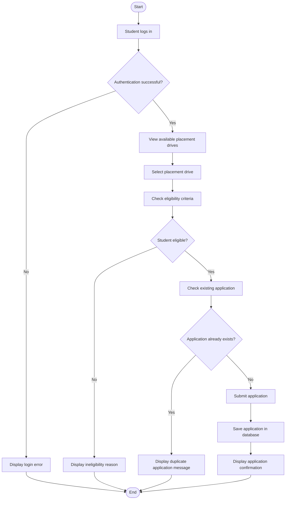

# EXPERIMENT 7: UML – SEQUENCE AND ACTIVITY DIAGRAM MODELING

## Project: Student Placement Management System

---

## 1. Aim

To design UML Sequence and Activity Diagrams for the Student Placement Management System to represent interactions between system components and model the workflow of the placement application process.

## 2. Objectives

1. To understand the purpose of UML Sequence Diagrams.
2. To identify the objects and participants involved in a system interaction.
3. To represent messages exchanged between objects in chronological order.
4. To understand the purpose of UML Activity Diagrams.
5. To model workflows using activities, decisions and control flows.
6. To apply interaction and workflow modeling techniques used in software engineering.

## 3. Tools Required

- Draw.io (diagrams.net)
- StarUML
- Mermaid for text-based diagram representation
- GitHub for documentation

---

# 4. Introduction

The Student Placement Management System is a web-based application designed to manage campus placement activities.

Students can maintain their profiles, view placement drives, check eligibility and submit applications. Recruiters can review applications, shortlist candidates and schedule interviews. Placement officers can monitor placement activities and view reports.

UML Sequence Diagrams and Activity Diagrams represent different aspects of system behaviour.

- **Sequence Diagram:** Represents interactions between objects in chronological order.
- **Activity Diagram:** Represents the workflow of a process, including activities, decisions and alternative paths.

Both diagrams help developers understand the application's behaviour before implementation.

---

# 5. UML Sequence Diagram

## 5.1 Definition

A UML Sequence Diagram is an interaction diagram that represents how actors and objects communicate with each other over time.

It shows the participants involved in an operation, the messages exchanged between them and the order in which those messages occur.

## 5.2 Purpose

The Sequence Diagram is used to:

1. Represent communication between system components.
2. Show the chronological order of operations.
3. Identify the responsibilities of individual components.
4. Understand interactions between the frontend, backend and database.
5. Help developers implement and test system workflows.

## 5.3 Selected Use Case: Apply for Placement Drive

**Primary Actor:** Student

**Supporting Components:**
- Web Frontend
- Application Controller
- Application Service
- Eligibility Service
- Application Repository
- Database

**Preconditions:**
- The student is authenticated.
- The placement drive exists and is open.
- The student profile contains the required eligibility information.

**Postconditions:**
- If the application is valid, it is saved and a confirmation is returned.
- If eligibility or validation fails, the application is not created.

## 5.4 Sequence Diagram

## 5.5 Explanation of Message Flow

1. The student selects a placement drive and clicks Apply.
2. The frontend sends the application request to the backend controller.
3. The controller forwards the request to the application service.
4. The application service requests an eligibility check.
5. The eligibility service returns the result.
6. If the student is eligible, the application service checks for a duplicate application.
7. If no duplicate exists, the repository stores the application in the database.
8. The backend returns a success response.
9. The frontend displays the confirmation message.
10. If eligibility fails or a duplicate exists, the system returns an appropriate error instead of creating another application.

## 5.6 Participants and Responsibilities

| Participant | Responsibility |
|---|---|
| Student | Initiates the application |
| Web Frontend | Collects input and displays the response |
| Application Controller | Receives and validates the API request |
| Application Service | Coordinates the application workflow |
| Eligibility Service | Checks placement eligibility |
| Application Repository | Retrieves and saves application records |
| Database | Stores application information |

---

# 6. UML Activity Diagram

## 6.1 Definition

A UML Activity Diagram represents the flow of activities within a system or business process.

It describes the sequence of actions, decision points, alternative paths and completion conditions in a workflow.

## 6.2 Purpose

The Activity Diagram is used to:

1. Model business processes.
2. Represent the flow of control between activities.
3. Show decisions and alternative execution paths.
4. Identify the start and end of a workflow.
5. Improve understanding of application logic.
6. Support implementation and test-case design.

## 6.3 Selected Workflow: Student Placement Application

The selected workflow covers the process from student login to successful application submission or rejection.

### Main Activities

- Student login
- View placement drives
- Select a placement drive
- Check eligibility
- Check for duplicate applications
- Submit application
- Store application details
- Display the final result

## 6.4 Activity Diagram

## 6.5 Explanation of Activity Flow

1. The workflow begins when the student attempts to log in.
2. The system verifies the student's credentials.
3. If authentication fails, an error message is displayed and the workflow ends.
4. If authentication succeeds, the student views available placement drives.
5. The student selects a placement drive.
6. The system checks the student's eligibility.
7. If the student is ineligible, the system displays the reason.
8. If the student is eligible, the system checks whether an application already exists.
9. If a duplicate application exists, the system prevents another submission.
10. Otherwise, the application is submitted and saved.
11. The system displays a confirmation message.
12. The workflow ends.

---

# 7. Difference Between Sequence and Activity Diagrams

| Basis | Sequence Diagram | Activity Diagram |
|---|---|---|
| Main purpose | Represents interactions between participants | Represents the flow of activities |
| Focus | Messages and their chronological order | Workflow and control flow |
| Elements | Actors, lifelines and messages | Activities, decisions and control flows |
| Time representation | Explicit chronological ordering | Workflow progression |
| Best suited for | API calls and object interactions | Business processes and decision logic |
| Example in this project | Student application submission interactions | Complete placement application workflow |

---

# 8. Industry Mapping: Interaction and Workflow Modeling

Sequence and Activity Diagrams are commonly used during software analysis and design.

## 8.1 Sequence Diagram in Industry

Sequence Diagrams help developers understand communication between application components.

In the Student Placement Management System, the sequence diagram illustrates how the frontend, controller, service, eligibility service, repository and database cooperate to process an application.

This is useful for:

- API design
- Backend implementation
- Debugging request flows
- Identifying component responsibilities
- Designing integration tests

## 8.2 Activity Diagram in Industry

Activity Diagrams help teams understand business workflows and decision logic.

In the placement system, the activity diagram represents the conditions under which a student can successfully submit an application.

This is useful for:

- Business process modeling
- Requirement validation
- Identifying alternative paths
- Designing test cases
- Communicating workflow rules to stakeholders

---

# 9. Advantages

1. Improves understanding of system behaviour.
2. Clarifies interactions between components.
3. Identifies decision points and alternative flows.
4. Supports backend and frontend implementation.
5. Helps identify missing validation steps.
6. Improves communication among developers and stakeholders.
7. Provides a basis for testing and debugging.
8. Supports structured software design.

---

# 10. Conclusion

The UML Sequence Diagram and Activity Diagram were designed for the Student Placement Management System.

The Sequence Diagram represents the chronological interactions between the student, frontend, backend services and database during application submission.

The Activity Diagram represents the workflow, including authentication, eligibility verification, duplicate checking and application submission.

Together, these diagrams provide a clear understanding of system interactions and workflow logic before implementation.

---

# 11. Result

The experiment was completed successfully. A UML Sequence Diagram and a UML Activity Diagram were prepared for the Student Placement Management System to model application interactions and workflow behaviour.
