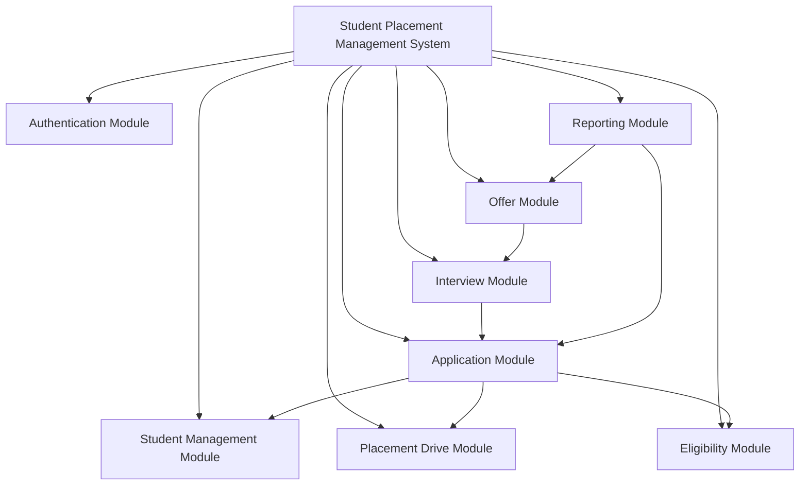
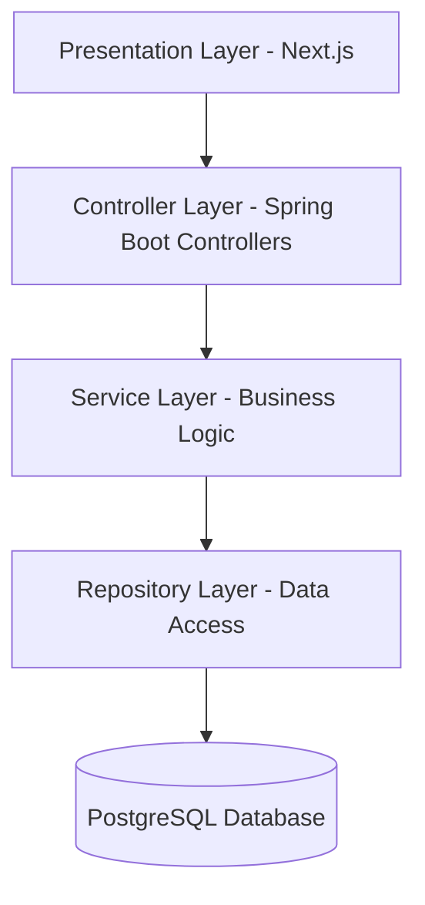

# Experiment 8: Software Design Principles

## 1. Aim

To analyze and apply fundamental software design principles, including modularization, coupling and cohesion, function-oriented versus object-oriented design, and top-down versus bottom-up design, using the Student Placement Management System as a case study.

## 2. Objectives

- To understand the importance of modularization in software design.
- To analyze coupling and cohesion among software modules.
- To compare function-oriented and object-oriented design approaches.
- To understand top-down and bottom-up design methodologies.
- To prepare a design analysis report based on industry software engineering practices.

## 3. Tools and Technologies

- Programming Language: Java
- Backend Framework: Spring Boot
- Database: PostgreSQL
- Frontend: Next.js / React
- Documentation and Diagrams: Markdown and Mermaid
- Version Control: Git and GitHub

*Note: These technologies represent the proposed technology stack for the Student Placement Management System.*

## 4. Introduction

Software design is the process of transforming software requirements into a structured solution that describes the system's architecture, modules, interfaces, and interactions.

A good software design improves maintainability, reusability, scalability, testability, and reliability.

The Student Placement Management System is designed to manage student profiles, placement drives, applications, eligibility verification, interviews, and offers. Applying software design principles helps organize these responsibilities into manageable and independent modules.

## 5. Modularization

### 5.1 Definition

Modularization is the process of dividing a software system into smaller, independent, and manageable units called modules. Each module performs a specific responsibility and interacts with other modules through well-defined interfaces.

### 5.2 Modularization in the Student Placement Management System

The system can be divided into the following modules:

| Module | Responsibility |
|---|---|
| Authentication Module | Handles login, logout, and access control. |
| Student Management Module | Manages student profiles and academic details. |
| Placement Drive Module | Creates and manages placement drives. |
| Eligibility Module | Checks whether students satisfy placement criteria. |
| Application Module | Handles applications and application status. |
| Resume Module | Manages student resumes. |
| Interview Module | Manages interview schedules and results. |
| Offer Module | Records placement offers and their status. |
| Reporting Module | Generates placement statistics and reports. |

### 5.3 Modular Architecture

### 5.4 Advantages of Modularization

1. **Maintainability:** Individual modules can be updated without unnecessarily changing the entire system.
2. **Reusability:** Common functionality can be reused by different parts of the application.
3. **Testability:** Modules can be tested independently.
4. **Scalability:** New features can be introduced with fewer changes to existing modules.
5. **Team Collaboration:** Different developers can work on separate modules.
6. **Fault Isolation:** Problems can be identified more easily within a specific module.

## 6. Coupling and Cohesion Analysis

### 6.1 Coupling

Coupling refers to the degree of dependency between different software modules.

**Low coupling is desirable** because changes in one module should have minimal impact on other modules.

For example, the Application Module should interact with the Eligibility Module through a clearly defined service interface instead of directly accessing its internal implementation.

Types of coupling, from generally less desirable to more desirable design choices:

- **Content Coupling:** One module directly modifies or depends on another module's internal implementation.
- **Common Coupling:** Multiple modules share mutable global data.
- **Control Coupling:** One module passes flags that control the internal behavior of another module.
- **Stamp Coupling:** Modules pass a large data structure when only part of it is required.
- **Data Coupling:** Modules communicate through the data they actually need.
- **Message Coupling:** Modules communicate through messages or public interfaces without depending on internal details.

*Note: Coupling classifications and their ordering can vary slightly across software engineering references.*

### 6.2 Cohesion

Cohesion refers to how closely related the responsibilities within a single module are.

**High cohesion is desirable** because a module should focus on one clear responsibility.

Common types of cohesion, from generally weaker to stronger:

- **Coincidental Cohesion:** Unrelated tasks are grouped together.
- **Logical Cohesion:** Similar categories of tasks are grouped together but selected through conditions.
- **Temporal Cohesion:** Tasks performed at the same time are grouped together.
- **Procedural Cohesion:** Tasks are grouped because they follow a particular sequence.
- **Communicational Cohesion:** Tasks operate on the same data.
- **Sequential Cohesion:** The output of one task becomes the input of another.
- **Functional Cohesion:** All responsibilities contribute to one well-defined function.

### 6.3 Coupling and Cohesion in the Proposed System

| Module | Coupling Analysis | Cohesion Analysis |
|---|---|---|
| Authentication | Uses defined authentication interfaces. | Focuses on identity verification and access control. |
| Student Management | Exposes student-related operations through a service layer. | Focuses on student profile management. |
| Eligibility | Receives required student and drive information. | Focuses on eligibility rule evaluation. |
| Application | Uses student, drive, and eligibility services. | Focuses on the application lifecycle. |
| Reporting | Retrieves necessary information through defined interfaces. | Focuses on reports and placement statistics. |

### 6.4 Design Improvements

To achieve low coupling and high cohesion:

1. Keep each module responsible for a specific business capability.
2. Use interfaces and dependency injection rather than tightly hard-coded dependencies.
3. Avoid sharing mutable global state.
4. Separate business logic from database access and user interface code.
5. Use appropriate DTOs to transfer only the information required.
6. Write unit tests for modules independently.

## 7. Function-Oriented vs Object-Oriented Design

### 7.1 Function-Oriented Design

Function-oriented design organizes software around functions or processes. The system is decomposed into operations that transform input data into output data.

Example functions in the Student Placement Management System:

- `registerStudent()`
- `createPlacementDrive()`
- `checkEligibility()`
- `applyForDrive()`
- `scheduleInterview()`
- `generatePlacementReport()`

### 7.2 Object-Oriented Design

Object-oriented design organizes software around objects that combine data and behavior.

Possible classes include:

- `Student`
- `Recruiter`
- `PlacementDrive`
- `Application`
- `Interview`
- `Offer`

For example, the `Student` class may contain student details and operations related to updating a profile, while the `Application` class represents a student's application to a placement drive.

### 7.3 Comparison

| Basis | Function-Oriented Design | Object-Oriented Design |
|---|---|---|
| Main focus | Functions and processes | Objects and their interactions |
| Decomposition | Divides the system into functions | Divides the system into classes and objects |
| Data handling | Data is passed between functions | Data and behavior are encapsulated together |
| Reusability | Achieved through reusable functions | Achieved through classes, composition, and interfaces |
| Maintainability | Can become difficult when data structures change across many functions | Encapsulation can localize changes |
| Modeling | Emphasizes process flow | Models entities and their relationships |
| Suitable examples | Data transformation pipelines and procedural programs | Business applications and domain-driven systems |

### 7.4 Application to the Project

For the Student Placement Management System, object-oriented design is suitable because the domain contains entities such as students, placement drives, applications, interviews, and offers with their own attributes and behaviors.

Java and Spring Boot support object-oriented design through classes, interfaces, encapsulation, composition, and dependency injection.

Function-oriented decomposition remains useful for identifying individual operations within these objects and services.

## 8. Top-Down and Bottom-Up Design

### 8.1 Top-Down Design

Top-down design starts with the complete system and progressively divides it into smaller subsystems and modules.

In the Student Placement Management System:

1. Identify the overall placement management system.
2. Divide it into authentication, student management, placement drives, applications, interviews, and reporting.
3. Break each module into services and operations.
4. Define interfaces, database interactions, and implementation details.

**Advantage:** Provides a clear understanding of the overall system and ensures that modules align with business requirements.

**Limitation:** Low-level implementation details may be discovered later, and early assumptions may need revision.

### 8.2 Bottom-Up Design

Bottom-up design starts by developing smaller, reusable components and gradually combines them into larger subsystems.

In the Student Placement Management System:

1. Define reusable components such as validators, repositories, and notification interfaces.
2. Implement student and placement-drive data access components.
3. Combine these components into services.
4. Integrate services into complete application workflows.

**Advantage:** Encourages reusable components and allows lower-level functionality to be tested early.

**Limitation:** Individual components may not fit together well if system-wide requirements and interfaces are not defined in advance.

### 8.3 Comparison

| Basis | Top-Down Design | Bottom-Up Design |
|---|---|---|
| Starting point | Overall system | Individual components |
| Direction | General to specific | Specific to general |
| Main focus | System structure and requirements | Reusable components and implementation |
| Testing support | High-level testing may initially use stubs | Component testing may initially use drivers |
| Major advantage | Clear architectural direction | Early validation and component reuse |
| Major limitation | Low-level details may be overlooked initially | Overall integration can become difficult |
| Project application | Identifying modules from placement requirements | Building and integrating reusable services |

### 8.4 Recommended Approach

A **hybrid approach** is recommended for the Student Placement Management System.

First, use top-down design to identify system modules and their responsibilities. Then use bottom-up development to implement and test reusable components before integrating them into complete workflows.

This approach combines architectural clarity with practical component reuse.

## 9. Proposed Design Structure

The proposed application can follow a layered architecture:

### Layer Responsibilities

- **Presentation Layer:** Displays information and accepts user input.
- **Controller Layer:** Receives HTTP requests, validates request structures, and returns responses.
- **Service Layer:** Implements business rules such as eligibility verification and application processing.
- **Repository Layer:** Handles persistence and database queries.
- **Database Layer:** Stores students, placement drives, applications, interviews, and offers.

The layered architecture separates responsibilities and helps reduce unnecessary dependencies between the user interface, business logic, and data access.

## 10. Industry Mapping: Software Design Engineering

Software Design Engineering applies structured design principles to build software that is maintainable, testable, reliable, and scalable.

The following practices map the concepts in this experiment to industry workflows:

| Design Principle | Industry Application |
|---|---|
| Modularization | Organizing code into modules, packages, and services |
| Low Coupling | Defining interfaces and minimizing dependencies |
| High Cohesion | Assigning a single clear responsibility to each module |
| Object-Oriented Design | Modeling domain entities and their behavior |
| Top-Down Design | Designing architecture from business requirements |
| Bottom-Up Design | Building reusable components and integrating them |
| Layered Architecture | Separating presentation, business logic, and persistence |
| Independent Testing | Unit testing modules and integration testing interactions |
| Version Control | Managing changes through Git and GitHub |

### Practical Design Recommendations

1. Define module responsibilities before implementation.
2. Establish clear interfaces between modules.
3. Keep business rules inside the service layer.
4. Avoid unnecessary complexity and premature microservice decomposition.
5. Review coupling and cohesion during code reviews.
6. Test both individual modules and their interactions.
7. Document architectural decisions so future developers understand the design.

## 11. Expected Outcomes

After applying these design principles, the proposed system should have:

- A clear and modular structure.
- Better separation of responsibilities.
- Reduced unnecessary dependencies.
- Improved testability and maintainability.
- A design that supports future feature additions.
- A documented approach to component integration.

These are expected design benefits; they are not claims that the complete application has already been implemented or benchmarked.

## 12. Conclusion

This experiment analyzed software design principles using the Student Placement Management System as a case study. Modularization divides the application into manageable units, low coupling and high cohesion improve maintainability, object-oriented design models the system's entities and behaviors, and top-down and bottom-up design provide complementary approaches to system development.

A hybrid design strategy, supported by a layered architecture and clearly defined interfaces, is recommended for developing a maintainable and extensible placement management application.

## 13. Result

The Design Analysis Report was prepared by applying modularization, coupling and cohesion analysis, function-oriented versus object-oriented design, and top-down versus bottom-up design to the proposed Student Placement Management System. The report identifies suitable design practices aligned with Software Design Engineering.
