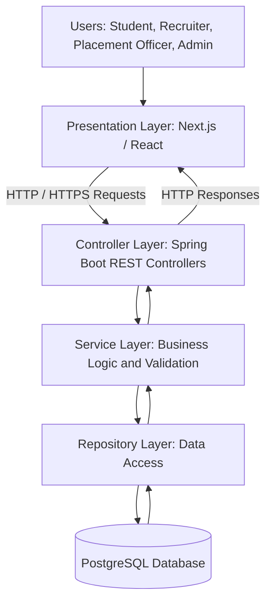
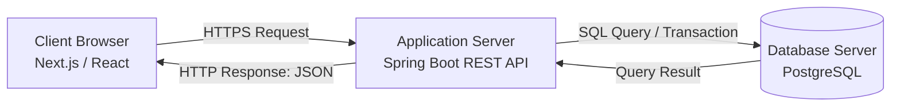
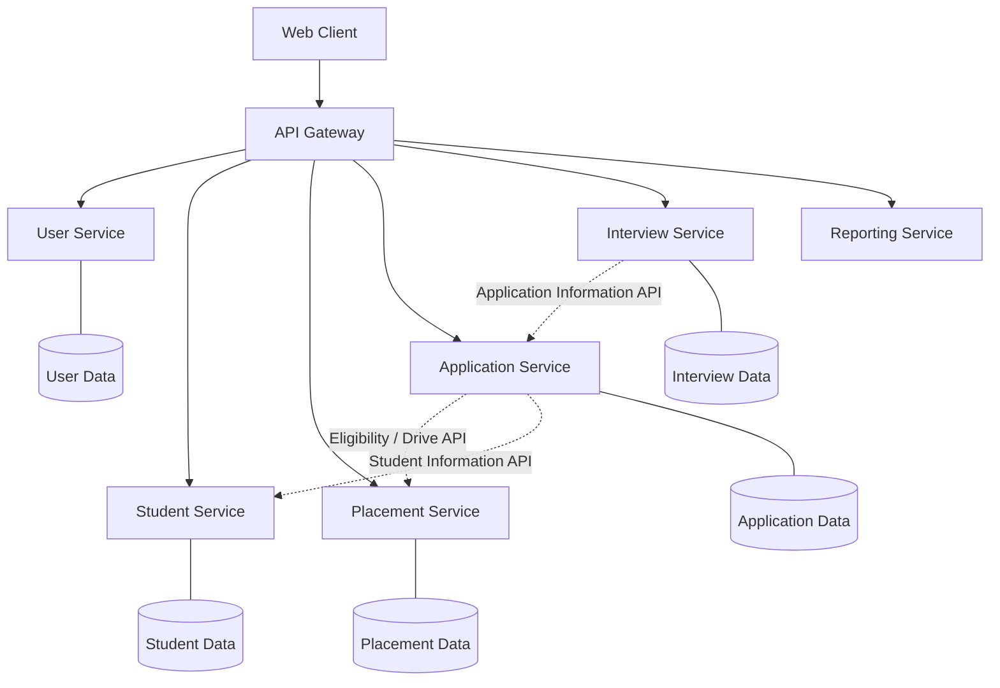

# Experiment 9: Software Architecture Design and Design Patterns

## 1. Aim

To design and analyze the software architecture of the Student Placement Management System using layered architecture, the client-server model, and the conceptual understanding of microservices.

## 2. Objectives

- To understand the importance of software architecture.
- To design a layered architecture for the proposed system.
- To understand client-server communication.
- To study microservices architecture conceptually.
- To prepare a system architecture diagram following industry practices.

## 3. Tools and Technologies

- Frontend: Next.js / React
- Backend: Java and Spring Boot
- Database: PostgreSQL
- Architecture Diagrams: Mermaid
- Version Control: Git and GitHub

*Note: These technologies describe the proposed system design, not a claim that the complete system has been implemented.*

## 4. Introduction

Software architecture defines the high-level structure of a software system, its major components, their responsibilities, and how they communicate with one another.

A well-designed architecture improves maintainability, scalability, security, testability, and reliability.

The Student Placement Management System is intended to manage student profiles, placement drives, eligibility verification, applications, interviews, and placement offers. A suitable architecture is required to organize these features and maintain clear boundaries between different responsibilities.

## 5. Layered Architecture Design

### 5.1 Definition

Layered architecture organizes a software application into logical layers. Each layer has a specific responsibility and communicates with other layers through defined interfaces.

### 5.2 Proposed Layers

**1. Presentation Layer**

- Provides the user interface for students, recruiters, placement officers, and administrators.
- Displays placement drives, application statuses, and reports.
- Sends HTTP requests to the backend.

**2. Controller Layer**

- Receives incoming HTTP requests.
- Validates request structures and handles routing.
- Calls the appropriate service methods.
- Returns HTTP responses to the client.

**3. Service Layer**

- Contains business logic and application rules.
- Checks student eligibility for placement drives.
- Coordinates application submission and interview scheduling.
- Controls business operations and transaction boundaries where required.

**4. Repository Layer**

- Handles database operations.
- Retrieves and saves student profiles, placement drives, applications, interviews, and offers.
- Separates persistence logic from business logic.

**5. Database Layer**

- Stores application data in PostgreSQL.
- Maintains relationships and constraints between entities.
- Supports queries and transactions.

### 5.3 Layered Architecture Diagram

### 5.4 Advantages

- Separation of concerns.
- Easier testing and debugging.
- Better maintainability.
- Clear responsibility boundaries.
- Easier replacement or modification of individual layers.

### 5.5 Design Consideration

The application should generally follow a clear dependency direction: controllers call services, services use repositories, and repositories access the database. Business logic should not be placed directly inside controllers.

## 6. Client-Server Architecture

### 6.1 Definition

Client-server architecture is a model in which a client requests services or resources from a server, and the server processes the request and returns a response.

### 6.2 Components

**Client:** The web browser running the Next.js/React application.

**Server:** The Spring Boot backend responsible for processing requests, applying business rules, and accessing data.

**Database Server:** PostgreSQL, which stores persistent application data.

### 6.3 Client-Server Communication Diagram

### 6.4 Example Workflow

When a student applies for a placement drive:

1. The student selects a placement drive in the browser.
2. The frontend sends an application request to the backend.
3. The backend authenticates the user and validates the request.
4. The service layer checks eligibility and whether an application already exists.
5. The repository saves the application in PostgreSQL if the checks pass.
6. The backend returns a success or error response.
7. The frontend displays the result to the student.

### 6.5 Advantages

- Centralized business logic and data management.
- Easier maintenance and updates.
- Multiple clients can use the same backend API.
- Access control can be enforced on the server.
- Client and server responsibilities remain separate.

### 6.6 Security Considerations

- Use HTTPS for communication.
- Authenticate users and enforce role-based authorization.
- Validate input on the server.
- Keep database credentials on the backend.
- Never rely only on frontend validation for security.

## 7. Microservices Architecture — Conceptual Study

### 7.1 Definition

Microservices architecture organizes an application as a collection of small, independently deployable services. Each service owns a specific business capability and communicates with other services through APIs or messaging.

Unlike a traditional monolithic backend, microservices can be deployed and scaled independently, but they introduce additional operational and architectural complexity.

### 7.2 Possible Microservices for the Project

If the Student Placement Management System grows substantially, its business capabilities could conceptually be separated into:

- **User Service:** Authentication, roles, and account management.
- **Student Service:** Student profiles and academic information.
- **Placement Service:** Placement drive management and eligibility criteria.
- **Application Service:** Application submission and status tracking.
- **Interview Service:** Interview scheduling and results.
- **Notification Service:** Email or other notification delivery.
- **Reporting Service:** Placement statistics and analytical reports.

These services are conceptual design options, not currently implemented independent services.

### 7.3 Conceptual Microservices Diagram

*The diagram illustrates a possible future architecture. The dashed lines represent conceptual service-to-service communication. Each service's data ownership is a design option, not an implementation claim.*

### 7.4 Advantages of Microservices

- Independent deployment of services.
- Independent scaling of high-demand capabilities.
- Better isolation of some service failures.
- Flexibility to evolve individual services.
- Clear ownership of business capabilities.

### 7.5 Challenges of Microservices

- More complex deployment and monitoring.
- Network latency and communication failures.
- Distributed data consistency and transaction challenges.
- More demanding security and configuration management.
- Increased infrastructure and operational costs.
- More complex integration testing.

### 7.6 Monolithic vs Microservices Architecture

| Basis | Monolithic Architecture | Microservices Architecture |
|---|---|---|
| Structure | One deployable application | Multiple independently deployable services |
| Deployment | Usually deployed together | Services can be deployed independently |
| Scaling | Often scales the application as a whole | Individual services can scale independently |
| Communication | Often uses in-process calls | Commonly uses network APIs or messaging |
| Complexity | Generally simpler initially | Higher operational complexity |
| Data management | Commonly uses a shared database | Services often own their data |
| Best suited for | Small to medium applications and early-stage systems | Systems with justified independent scaling and deployment needs |

### 7.7 Recommended Approach

For the initial Student Placement Management System, a **modular monolithic Spring Boot backend** is recommended.

It can use clearly separated packages or modules for students, placement drives, applications, interviews, and reporting while sharing one PostgreSQL database.

Microservices can be considered later if independent deployment, scaling, team ownership, or reliability requirements justify the additional complexity.

## 8. Design Patterns and Architectural Practices

Design patterns are reusable solutions to recurring software design problems. They are not complete architectures by themselves.

The following patterns and practices could support the proposed system:

| Pattern / Practice | Purpose | Possible Application |
|---|---|---|
| MVC | Separates request handling and presentation responsibilities | Spring Boot controllers and frontend views |
| Repository Pattern | Separates data access from business logic | Student and application repositories |
| Service Layer | Encapsulates business operations | Eligibility and application processing |
| Dependency Injection | Supplies dependencies without hard-coding their construction | Spring-managed services and repositories |
| DTO Pattern | Defines data transferred through API boundaries | Student profile and application request/response objects |
| API Gateway | Provides a common entry point for multiple services | A possible future microservices architecture |

*These are proposed design choices. The API Gateway is primarily relevant if the system later adopts multiple backend services.*

## 9. System Architecture Planning

The following planning decisions are recommended for the proposed application:

1. **Architecture style:** Layered architecture with a modular monolithic backend.
2. **Communication model:** Client-server using REST APIs over HTTPS.
3. **Frontend:** Next.js / React.
4. **Backend:** Java with Spring Boot.
5. **Database:** PostgreSQL.
6. **Security:** Authentication and role-based authorization.
7. **Business logic:** Implemented in the service layer.
8. **Data access:** Isolated through repository interfaces.
9. **Testing:** Unit tests for business logic and integration tests for API/database interactions.
10. **Future evolution:** Evaluate microservices only when there is a clear business or technical need.

## 10. Industry Mapping: System Architecture Planning

System Architecture Planning is the industry practice of selecting architecture styles, defining component responsibilities, documenting interactions, and evaluating trade-offs before implementation.

| Industry Practice | Application in This Project |
|---|---|
| Architecture Selection | Choosing a layered modular monolith initially |
| Component Decomposition | Separating student, placement, application, and interview responsibilities |
| Interface Design | Defining REST endpoints and service interfaces |
| Data Architecture | Planning PostgreSQL tables and relationships |
| Security Architecture | Enforcing authentication and authorization on the backend |
| Scalability Planning | Identifying potential high-demand modules |
| Architecture Documentation | Maintaining diagrams and design decisions |
| Evolution Planning | Considering microservices only when justified |
| Quality Assurance | Testing modules, APIs, and database interactions |

## 11. Expected Outcomes

The proposed architecture is expected to provide:

- A clear separation of presentation, business logic, and persistence.
- A documented client-server communication model.
- A conceptual understanding of microservices and their trade-offs.
- A practical foundation for implementing the Student Placement Management System.
- A path for future architectural evolution without premature complexity.

These are expected design benefits, not measured results from a completed implementation.

## 12. Conclusion

This experiment presented the software architecture design of the Student Placement Management System using layered architecture and the client-server model. It also examined microservices conceptually, including their benefits, challenges, and potential application.

A layered modular monolith is recommended for the initial version because it offers clear separation of responsibilities with lower operational complexity. Microservices may be introduced in the future if independent deployment, scaling, or organizational needs justify them.

## 13. Result

The System Architecture Diagram and supporting analysis were prepared for the proposed Student Placement Management System. The report documents the layered architecture, client-server interactions, conceptual microservices design, and architecture planning decisions relevant to Software Architecture Engineering.
